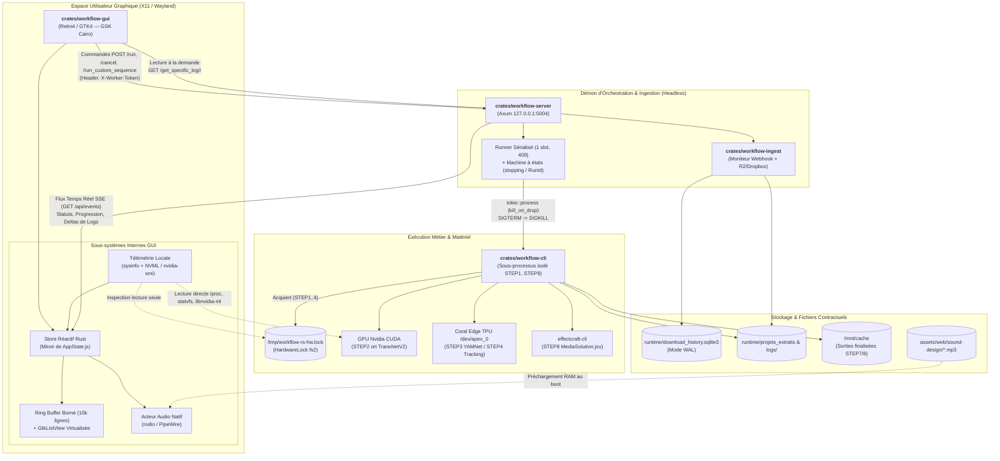

# ADR-001 : Étude de Faisabilité et Architecture de Migration vers un Client GUI Linux Natif (X11 / Wayland)

| Champ | Valeur |
| --- | --- |
| Type | Étude externe |
| Statut | Historique — non normative |
| Date | 2026-10-24 |
| Portée | ADR-001 : faisabilité et architecture d'un client GUI Linux natif. |
| Voir aussi | `docs/desktop/ETUDE-GUI-NATIVE-LINUX.md`, `docs/audits/2026-10-24-confrontation-etudes-gui-linux.md` |

* **Auteur** : Principal Rust & Linux Systems Architect
* **Cible** : Workspace `workflow-rs` (Rust 1.86+, Linux Workstation Ubuntu/Debian, X11 & Wayland)


* **Références contractuelles** : `docs/contracts/CONTRAT-ENVIRONNEMENT.md`, `.agents/rules/codingstandards.md`, `parity/DRIFT.md`


---

## TL;DR — Synthèse Exécutive

**Décision recommandée** : Conserver **`workflow-server` (`:5004`) intact en tant que démon d'orchestration et d'ingestion headless**, et ajouter un dixième crate au workspace, **`crates/workflow-gui`**, implémenté sous forme de **client lourd Linux natif découplé (Topologie A)** basé sur **Relm4 / GTK4** (avec **Iced** en alternative 100 % Rust).

Ce découplage garantit qu'une fermeture de fenêtre ou un redémarrage du compositeur X11/Wayland n'interrompt jamais ni le moniteur d'ingestion (`workflow-ingest`), ni une étape matérielle longue (STEP2 CUDA, STEP3/STEP4 Coral Edge TPU, STEP8 `effectcraft-cli`), tout en résolvant nativement le goulet d'étranglement du DOM sur les flux massifs de logs et l'absence des routes de monitoring système (`D-015`) côté serveur Rust.

---

## 1. Analyse Critique des Composants du Snapshot

### 1.1. Cartographie des interactions Frontend (`assets/web/`) ↔ Backend (`crates/workflow-server`)

Dans l'architecture actuelle, `workflow-server` (basé sur `axum` 0.8) remplit un double rôle : orchestrateur de sous-processus `workflow-cli` et serveur d'assets web pour une copie non modifiée du frontend historique Python (`assets/web/`).

1. **Prétraitement de gabarit et injection de contexte (`crates/workflow-server/src/http.rs`)** :
* Le serveur Rust ne modifie pas les fichiers de `assets/web/`, mais applique à la volée une passe de réécriture (`preprocess_template`) sur `assets/web/templates/index_new.html` avant le rendu **Minijinja**.


* Cette passe convertit la syntaxe Flask/Jinja2 vers Minijinja : `url_for('static', filename='...')` devient `/static/...`, `steps_config.items()` devient `steps_config|items`, `csrf_token()` est remplacé par une chaîne vide, `worker_token if worker_token else ''` devient `worker_token`, et `steps_config | tojson | safe` devient `steps_config_json | safe` (sérialisé côté Rust).


* Le HTML généré injecte le jeton de sécurité dans une balise `<meta name="worker-token" content="...">` consommée au démarrage par `assets/web/static/apiService.js`.


2. **Contrat de communication HTTP (`apiService.js` ↔ `http.rs`)** :
* **Exécution unitaire** : `runStepAPI(stepKey)` appelle `POST /run/<stepKey>` via `fetchWithLoadingState`. Si la réponse retourne `{ "status": "initiated" }`, le frontend passe le badge à `status-starting`, démarre le chronomètre local (`ui.startStepTimer`) et active le polling.


* **Arrêt et annulation** : `cancelStepAPI(stepKey)` envoie `POST /cancel/<stepKey>` (ou `POST /stop/<stepKey>`) avec l'en-tête `X-Worker-Token`.


* **Suivi d'état et logs** : `startPollingAPI(stepKey)` interroge `GET /status/<stepKey>?t=<timestamp>` qui retourne l'état complet : `status`, `progress_current`, `progress_total`, `progress_text`, `return_code`, `is_any_sequence_running` et le tableau complet `log: Vec<String>`. Une route légère sans logs existe également (`GET /api/step_status/<stepKey>`) ainsi que `GET /sequence/status` pour les séquences.


* **Journaux spécifiques** : `fetchSpecificLogAPI(stepKey, logIndex, logName)` appelle `GET /get_specific_log/<stepKey>/<logIndex>` pour lire les journaux détaillés sur disque (`runtime/logs/step_STEPx.log` ou sous-dossiers `runtime/logs/stepN/`).


* **Ingestion Webhook & Téléchargements** : `fetchCSVMonitorStatusAPI()` et `fetchLocalDownloadsStatusAPI()` sondent respectivement `GET /api/csv_monitor_status` et `GET /api/csv_downloads_status` (alimentés par le crate `workflow-ingest`).


3. **Divergence critique identifiée dans le snapshot : la décision `D-015` (Routes Python-only)** :
* D'après `AGENTS.md` et `.agents/rules/codingstandards.md`, les routes de gestion du cache (`clear_disk_cache`), de statistiques, de diagnostics système (`/api/system_monitor`) et `/api/audio/*` sont **intentionnellement restées dans le legacy Python (`D-015`)** et ne sont pas portées dans `workflow-server`.


* Pourtant, le frontend copié dans `assets/web/static/` contient toujours le code hérité (`stats-dashboard.css`, gestion de `clear_disk_cache` dans `apiService.js`).


* **Opportunité architecturale pour la GUI native** : Au lieu de violer `D-015` en alourdissant `workflow-server` avec des routes de télémétrie matérielle, une GUI Linux native tournant sur la même workstation peut collecter les métriques CPU, RAM, Disque (`/mnt/cache`, `runtime/`) et GPU Nvidia directement auprès du noyau Linux et de NVML.


---

### 1.2. Invariants métier et de sécurité à préserver impérativement

Toute migration vers une interface native doit respecter les garde-fous codifiés dans `.agents/rules/codingstandards.md` et `AGENTS.md` :

| Invariant | Implémentation actuelle dans le snapshot | Exigence pour la GUI native |
| --- | --- | --- |
| **Authentification des mutations (`X-Worker-Token`)** | `fetchWithLoadingState` lit `<meta name="worker-token">` et injecte l'en-tête `X-Worker-Token`. Le serveur refuse les jetons vides ou préfixés par `dev-` et vérifie le secret via `subtle` (temps constant).

 | La GUI doit lire `WORKFLOW_SERVER_WORKER_TOKEN` depuis l'environnement (`config/launcher.env`) et l'injecter systématiquement dans l'en-tête `X-Worker-Token` de son client HTTP.

 |
| **Sérialisation stricte d'exécution (HTTP 409)** | `workflow-server` n'autorise qu'une seule étape ou séquence active à la fois. Tout second lancement simultané est rejeté en `409 Conflict`.

 | L'état local de la GUI doit verrouiller les boutons `.run-button` dès que `isAnySequenceRunning` ou qu'une étape est active, et gérer proprement le code HTTP `409`.

 |
| **Machine à états d'arrêt (`stopping` & `RunId`)** | Lors d'un `stop`/`cancel`, le serveur passe l'étape en `stopping`, envoie `SIGTERM` puis `SIGKILL` au sous-processus `workflow-cli` (ou au groupe de processus pour STEP8 `effectcraft-cli`), et **garde le créneau occupé jusqu'à la mort réelle de l'enfant**. Tout `finish_step` périmé est ignoré grâce à son `RunId`.

 | La GUI ne doit jamais supposer qu'une étape est arrêtée dès l'envoi du `POST /cancel/<step>` : elle doit afficher un état transitoire `stopping` et interdire toute relance tant que le serveur n'a pas publié l'état terminal `stopped`, `cancelled` ou `failed`.

 |
| **Verrouillage matériel exclusif (`HardwareLock`)** | `workflow-cli` prend un verrou fichier (`fs2`) sur `hardware.lock_path` (`/tmp/workflow-rs-hw.lock`) autour de STEP1 (normalisation vidéo) et STEP2/3/4.

 | La GUI ne doit **jamais** instancier de session ONNX CUDA, de délégué TFLite Edge TPU (`/dev/apex_0`) ni prendre `/tmp/workflow-rs-hw.lock` elle-même.

 |
| **Isolation des données (`runtime/` & `/mnt/cache`)** | `workflow-core` impose que `history_db`, `projects`, `archives`, `logs` et `downloads` restent sous `paths.base` (`runtime/`).

 | La GUI agit en lecture/pilotage pur via `workflow-server` et `workflow-core::config` sans jamais écrire directement dans `runtime/` ou `/mnt/cache`.

 |

---

### 1.3. Analyse du volume et de la vélocité des données

L'examen de `assets/web/static/constants.js` et `apiService.js` met en évidence une pression importante sur la boucle d'événements du navigateur :

* **Vélocité du Polling** :
* En mode manuel, chaque étape active déclenche un `GET /status/<step>?t=...` toutes les **`500 ms`** (`POLLING_INTERVAL = 500`).


* En mode séquence automatique (`isAutoModeHighFrequency = true`), la fréquence monte à **`200 ms`** (`POLLING_INTERVAL_HIGH_FREQUENCY = 200`), soit **5 requêtes par seconde**, en plus des sondages périodiques de `/sequence/status`, `/api/csv_monitor_status` et `/api/csv_downloads_status`.


* **Amplification de bande passante et coût CPU/DOM sur les logs** :
* À chaque cycle de `200 ms` ou `500 ms`, la route `/status/<step>` renvoie l'intégralité du tampon de logs accumulé (`data.log`, joint côté JS par `data.log.join('')`).


* Or, les étapes d'inférence et de traitement média génèrent des flux soutenus :
* **STEP1 / STEP2 / STEP3 / STEP4** : logs de décodage `ffmpeg`, sorties de progression contractuelles (`TOTAL_*`, `PROCESSING_VIDEO`, `INTERNAL_PROGRESS`), traces d'inférence sur des vidéos de plusieurs milliers de frames (ex. `real_244` en ~44 s pour STEP4 et ~30 s par vidéo pour ECAPA en STEP3).


* **STEP8 (`effectcraft-cli`)** : passthrough complet des lignes `MS_BATCH_*` et des journaux `[INFO] / [WARNING] / [SUCCESS]` générés par `MediaSolution.jsx` sur chaque segment (ex. 82 segments sur le projet 250).


* Pour maintenir 60 FPS malgré la réécriture de milliers de nœuds `<span class="log-line ...">`, le frontend web actuel a dû empiler des palliatifs complexes : `parseWorker.js` / `WorkerManager.js`, `DOMBatcher.js` (`requestAnimationFrame`), et `DOMDiff.js`. Dans une GUI native Rust dotée d'une liste virtualisée et d'une réception incrémentale des logs, **90 % de cette complexité accidentelle disparaît**.


---

## 2. Évaluation Comparative des Frameworks GUI Rust sous Linux

Le poste cible est une **Workstation Linux** (Ubuntu/Debian, processeur AMD Threadripper, GPU Nvidia CUDA, accélérateur PCIe/M.2 Coral Edge TPU `/dev/apex_0`), exécutant X11 ou Wayland. Toute surcharge VRAM ou instabilité du driver graphique Nvidia impacte directement la disponibilité de STEP2 (`ort` CUDA, pic de 2,1 à 2,2 GiB de VRAM) et de STEP8 (`effectcraft-cli`).

### Candidat 1 : Tauri v2 (Hybride Web/Rust via `wry` / `webkit2gtk-4.1`)

* **Principe** : Encapsuler les fichiers existants `assets/web/` dans une fenêtre native Linux propulsée par `WebKitGTK`, en remplaçant ou complétant les appels `fetch` par des commandes IPC Tauri (`#[tauri::command]`) en Rust.


* **Avantages** :
* Effort de migration initial minimal : conservation à l'identique du CSS (`variables.css`, `steps.css`, `logs.css`) et de la logique JS (`AppState.js`, `sequenceManager.js`).


* Fidélité visuelle de 100 % au premier jour.


* **Inconvénients** :
* **Empreinte mémoire lourde** : Les sous-processus `WebKitWebProcess` et `WebKitNetworkProcess` consomment entre **180 Mio et 350 Mio de RSS** au repos, soit davantage que l'étape lourde STEP4 sur TPU (199,5 Mio de RSS sur `real_244`).


* **Friction connue WebKitGTK + Nvidia sous Wayland** : Sur Linux avec les pilotes propriétaires Nvidia, l'accélération DMA-BUF de `webkit2gtk` présente régulièrement des artefacts ou des plantages au lancement, obligeant souvent à exporter `WEBKIT_DISABLE_DMABUF_RENDERER=1` (ce qui dégrade les performances de rendu CSS).
* **Maintien de la dette technique** : Ne résout pas la surcharge du DOM sur les gros volumes de logs ni la dualité de langages (JS + Rust) dans un dépôt dont la philosophie est le "tout-Rust".


### Candidat 2 : Slint (Rust Natif Déclaratif)

* **Principe** : Décrire l'interface dans le langage déclaratif `.slint` (compilé en Rust à la compilation) avec un backend de rendu Skia, FemtoVG ou logiciel.
* **Avantages** :
* Empreinte RAM très faible (~25 à 45 Mio) et excellente réactivité des jauges et transitions.
* Séparation stricte entre la présentation (`.slint`) et la logique métier Rust.


* **Inconvénients** :
* **Limitation sur le visualiseur de logs** : Si le composant `ListView` de Slint supporte la virtualisation, la sélection de texte multi-lignes à la souris (copier-coller d'une trace d'erreur sur 30 lignes) et la recherche plein texte dans un flux continu y sont difficiles à implémenter.
* **Coût d'apprentissage d'un DSL externe** : Introduit un langage dédié (`.slint`) hors de l'écosystème de types Rust standard.
* **Contrainte de licence** : Slint impose un choix entre GPLv3, licence commerciale ou programme *Ambassador* avec attribution obligatoire.


### Candidat 3 : Iced (Architecture Elm 100 % Rust)

* **Principe** : Framework GUI déclaratif 100 % Rust basé sur le cycle `State` → `Message` → `update()` → `view()`, utilisant `wgpu` (Vulkan/GL) par défaut ou `tiny-skia` (rasterisation CPU) pour le rendu.
* **Avantages** :
* **Homologie parfaite avec l'architecture existante** : Le store immuable `assets/web/static/state/AppState.js` (`setState`, notifications par événement) se traduit directement dans le modèle Elm d'Iced (`Application::update`).


* **100 % Rust idiomatique** : Aucun DSL externe, typage fort de bout en bout, intégration native des `Subscription` asynchrones Tokio pour le streaming des logs et la télémétrie.


* **Inconvénients** :
* **Conflit potentiel GPU (`wgpu`)** : Par défaut, `iced_wgpu` alloue des buffers GPU Vulkan/OpenGL. Sur la machine de production, il est impératif de compiler ou configurer Iced sur son backend **`tiny-skia` (rendu logiciel CPU)** ou d'encadrer strictement son contexte GPU pour ne jamais perturber l'allocateur CUDA d'`ort` (STEP2).


* **Maturité des widgets complexes** : La virtualisation d'une liste de 50 000 lignes de logs avec hauteur dynamique (`word-break: break-all` de `logs.css`) et sélection de texte multi-lignes demande un widget personnalisé dans Iced.


### Candidat 4 : Relm4 / GTK4 + Libadwaita (Natif Linux / GNOME)

* **Principe** : Surcouche Rust réactive (modèle Elm : `Model`, `Msg`, `update`, macro `view!`) au-dessus des bindings officiels `gtk4-rs` et `libadwaita`.
* **Avantages** :
* **Intégration Linux X11 & Wayland de référence** : Gestion irréprochable du HiDPI/fractional scaling, des raccourcis clavier, du focus trap modal (`gtk::Window::set_modal`, `Escape` natif), et des notifications bureau via `Gio::Notification` (remplaçant `sendBrowserNotification` de `apiService.js`).


* **Moteur CSS natif intégré (`GtkCssProvider`)** : GTK4 embarque un moteur CSS supportant les variables et les classes. Les tokens de `.agents/skills/frontend-timeline-designer/resources/timeline_design_tokens.md` (`#1e1e2f`, `#2c2c3e`, `#7986cb`, badges `.state-running`, `.log-error`) sont **réutilisables quasi directement** dans une feuille `style.css` chargée par GTK4 !


* **Virtualisation industrielle des logs** : `gtk4::ListView` couplé à `gtk4::SignalListItemFactory` ou `gtk4::TextView` (avec `gtk4::TextBuffer` borné et `TextTag` pour la colorisation par niveau) gère des dizaines de milliers de lignes à 60/144 FPS sans saccade, avec sélection/copie native au clavier et à la souris.
* **Consommation mémoire contenue** : ~35 à 60 Mio de RSS, avec possibilité de forcer le renderer Cairo (`GSK_RENDERER=cairo`) pour garantir **0 Mio de VRAM** consommée sur la carte Nvidia pendant les runs CUDA.


* **Inconvénients** :
* Nécessite les bibliothèques système `libgtk-4-dev` et `libadwaita-1-dev` lors de la compilation (standard sur toute workstation Ubuntu/Debian).
* Verbosité inhérente au modèle d'objets GObject sous-jacent (largement masquée par les macros déclaratives de `relm4`).


### Candidat 5 : egui / eframe (Mode Immédiat)

* **Principe** : Interface en mode immédiat redessinée à chaque frame.
* **Avantages** :
* Extrême simplicité d'écriture en Rust pur ; `egui::ScrollArea::show_rows` virtualise nativement 100 000 lignes de logs en 10 lignes de code.


* **Inconvénients** :
* **Inadaptation au design système existant** : Reproduire la timeline verticale avec rail lumineux, connecteurs, cartes à rayon `20px`, badges pills et transitions fluides (`timeline_design_tokens.md`) est laborieux et anti-idiomatique en mode immédiat.


* Absence d'accessibilité native et rendu typographique inférieur à Pango/GTK4 sous Linux.


---

### Matrice Comparative Synthétique Pondérée

| Critère d'évaluation | Poids | 1. Tauri v2 (`webkit2gtk`) | 2. Slint | 3. Iced (`tiny-skia`/`wgpu`) | 4. Relm4 / GTK4 | 5. egui / eframe |
| --- | --- | --- | --- | --- | --- | --- |
| **Effort de migration** *(vitesse de portage)* | **15 %** | **5 / 5** *(réemploi JS/CSS)* | 3 / 5 *(DSL `.slint`)* | 3.5 / 5 *(Elm proche d'AppState)* | **4 / 5** *(Elm + réemploi CSS)* | 4 / 5 *(API immédiate)* |
| **Performance graphique & réactivité** | **25 %** | 3 / 5 *(DOM + WebKit IPC)* | **5 / 5** | 4.5 / 5 | **5 / 5** | 4.5 / 5 |
| **Empreinte RAM / VRAM & stabilité Linux (X11/Wayland)** | **25 %** | 2 / 5 *(~250 Mio RAM, bugs Wayland/Nvidia)* | 4.5 / 5 *(~35 Mio RAM)* | 4 / 5 *(~45 Mio RAM en `tiny-skia`)* | **5 / 5** *(~45 Mio RAM, Wayland natif, 0 VRAM en Cairo)* | 4 / 5 *(boucle GL/wgpu)* |
| **Facilité de virtualisation & copie des logs** | **20 %** | 2.5 / 5 *(DOMDiff coûteux)* | 3 / 5 *(copie multi-lignes limitée)* | 3 / 5 *(virtualisation manuelle)* | **5 / 5** *(`GtkListView` / `GtkTextView`)* | 4.5 / 5 *(`show_rows`)* |
| **Fidélité au design actuel & Accessibilité** | **15 %** | **5 / 5** | 4 / 5 | 4 / 5 | **4.5 / 5** *(GTK CSS + AT-SPI)* | 2 / 5 *(look utilitaire)* |
| **SCORE PONDÉRÉ (/ 5.00)** | **100 %** | **3.25 / 5** | **3.98 / 5** | **3.85 / 5** | **4.78 / 5** | **3.93 / 5** |

> **Verdict architectural** : **Relm4 (GTK4)** remporte l'évaluation haut la main (**4.78/5**) pour une station de travail Linux. Il combine le modèle réactif unidirectionnel de `AppState.js`, le support natif d'une feuille de style CSS reprenant les variables de `timeline_design_tokens.md`, une virtualisation native des logs via `gtk4::ListView`/`TextView`, et la possibilité d'utiliser le moteur de rendu `GSK_RENDERER=cairo` pour garantir une isolation VRAM totale vis-à-vis de STEP2 (CUDA). **Iced** constitue la meilleure alternative de repli si une stack 100 % Rust sans liaison dynamique `libgtk-4` est souhaitée.
> 
> 

---

## 3. Choix de la Topologie Logicielle : Découplé vs Monolithique

### Analyse comparative des deux topologies

#### Topologie A (Recommandée) : Client GUI Découplé (`workflow-gui` $\leftrightarrow$ `workflow-server` `:5004`)

L'application graphique est compilée dans un binaire distinct (`crates/workflow-gui`) qui communique en loopback (`127.0.0.1:5004`) avec `workflow-server` via HTTP REST (commandes mutantes) et SSE/WebSocket (flux d'événements et de logs).

* **Bénéfices critiques** :
1. **Indépendance absolue de l'ingestion (`workflow-ingest`)** : Le moniteur webhook (`webhook.enabled = true` dans `config/config.toml`) et les téléchargements résilients R2/Dropbox (`.part` + `Range`, sémaphore `max_concurrent = 4`, base `runtime/download_history.sqlite3`) tournent en tâche de fond dans `workflow-server`. Fermer la fenêtre GUI ne coupe aucun téléchargement ni la surveillance du webhook.


2. **Survie des pipelines longs** : Une séquence `STEP1` $\to$ `STEP8` dure plusieurs minutes à plusieurs heures. En Topologie A, l'opérateur peut fermer la GUI, redémarrer sa session graphique X11/Wayland et rouvrir `workflow-gui` : la GUI se resynchronise instantanément sur l'étape en cours et reprend l'affichage du flux de logs.


3. **Zéro régression sur les contrats d'exploitation** : Les scripts `scripts/switch-rust.sh`, `scripts/sync-backends.sh`, `scripts/validate-lot5.py` et le contrat `docs/contracts/CONTRAT-ENVIRONNEMENT.md` continuent de fonctionner sans modification.


4. **Isolation des verrous et du matériel** : Seul `workflow-server` spawne `workflow-cli`, qui seul acquiert `/tmp/workflow-rs-hw.lock`.


#### Topologie B (Rejetée) : Binaire Monolithique Tout-en-Un (GUI + Orchestrateur intégrés)

Fusionner la boucle d'événements graphique (`glib::MainContext` ou `winit`) avec l'état d'orchestration de `workflow-server` dans un seul processus.

* **Risques rédhibitoires** :
1. **Destruction des jobs sur fermeture de fenêtre** : Comme `workflow-server` spawne `workflow-cli` avec `kill_on_drop` pour éviter les processus orphelins, tout arrêt ou crash du processus GUI tuerait immédiatement les calculs CUDA/TPU ou le rendu `effectcraft-cli` en cours.


2. **Violation de l'unicité du moniteur Webhook** : Si l'utilisateur lance une seconde instance ou si un démon tourne déjà, deux moniteurs tenteraient d'accéder à `runtime/download_history.sqlite3` et au webhook, violant la règle d'or n°1 de `workflow-operator`.


3. **Rupture des outils de synchronisation** : `workflow-sync` vérifie l'écoute du port `:5004` avant d'autoriser une fusion Python $\leftrightarrow$ Rust.


### Diagramme d'Architecture Retenue (Topologie A)



---

## 4. Résolution Technique des Points Névralgiques sous Linux

### 4.1. Gestion du flux massif de logs : Ring Buffer borné & Virtualisation native

Dans le frontend web actuel, `uiUpdater.js` reçoit la totalité de `data.log` et applique des expressions régulières (`logParserUtils.js`, `logPatterns.js`) pour générer des éléments `<span class="log-line log-...">` injectés dans `#main-log-output-panel`.

Pour supporter plus de 50 000 lignes de logs à 60 FPS constants avec une empreinte RAM fixe (< 5 Mio) :

1. **Classification à la réception (hors thread UI)** :
* Le worker réseau Tokio de `workflow-gui` reçoit uniquement les **nouvelles lignes** de logs (via SSE ou curseur d'offset).
* Chaque ligne brute est immédiatement classifiée en une structure compacte `LogEntry { id: u64, level: LogLevel, text: SharedString }` reproduisant les 7 catégories de `assets/web/static/css/components/logs.css` (`Success`, `Warning`, `Error`, `Info`, `Debug`, `Command`, `Progress`).


2. **Buffer Circulaire Borné (`VecDeque<LogEntry>`)** :
* Le store conserve un `VecDeque<LogEntry>` borné à `MAX_LOG_LINES = 10_000`. Lorsque la capacité est atteinte, `pop_front()` évince la ligne la plus ancienne en $O(1)$ avant d'insérer la nouvelle via `push_back()`.


3. **Coalescence des mises à jour UI (Batching 16 ms / 60 Hz)** :
* Au lieu de déclencher un rafraîchissement graphique à chaque ligne émise par `ffmpeg` ou `workflow-cli`, le canal entre le worker Tokio et le thread UI regroupe les lignes par tranches de **`16 ms` (`60 Hz`)** (équivalent natif de `DOMBatcher.js`).


4. **Virtualisation par fenêtrage (`gtk4::ListView` + `SignalListItemFactory`)** :
* `gtk4::ListView` n'instancie de widgets `gtk4::Label` que pour les ~35 lignes effectivement visibles dans le viewport de `#main-log-container-panel` (plus un léger tampon de sur-allocation).


* Lors du défilement, les widgets sortants sont recyclés (`bind` / `unbind`) en changeant simplement leur texte et leur classe CSS (`.log-error`, `.log-progress`, etc.).


5. **Auto-scroll intelligent débrayable (parité avec `scrollManager.js`)** :
* Un écouteur sur le `gtk4::Adjustment` vertical (`vadjustment`) vérifie si `value + page_size >= upper - 24.0`. Si l'opérateur remonte dans les logs pour inspecter une erreur, le flag `stick_to_bottom` passe automatiquement à `false` pour ne jamais interrompre sa lecture ; un clic sur un bouton flottant *"⬇ Reprendre le défilement"* ou un retour en bas de liste le réactive.


---

### 4.2. Design sonore natif (`rodio` sur PipeWire / PulseAudio)

Le frontend actuel utilise `assets/web/static/soundManager.js` pour jouer les fichiers `.mp3` situés dans `server.sound_design_dir` (`assets/web/sound-design/`) lors des transitions d'étapes et des erreurs (`soundEvents.errorEvent()`).

* **Choix technologique** : Crate **`rodio` (v0.19+)** avec les features `mp3` (décodeur pur Rust `minimp3` / `symphonia`) et backend `cpal` (connecté nativement à PipeWire / PulseAudio / ALSA sous Linux).
* **Architecture sans latence ni blocage UI** :
* Au démarrage de `workflow-gui`, les fichiers `.mp3` du dossier configuré dans `config.server.sound_design_dir` sont lus une seule fois et stockés en mémoire sous forme de `HashMap<SoundEvent, Arc<[u8]>>`.


* Un thread d'arrière-plan léger maintient le `rodio::OutputStream` et écoute un canal borné `std::sync::mpsc::SyncSender<SoundCommand>`.
* Lorsque `GuiAppState` détecte une transition (ex. passage à `failed`, fin de séquence `completed`, clic de lancement), il envoie `SoundCommand::Play(SoundEvent::Error)` de manière non-bloquante (`try_send`), uniquement si le toggle `sound_enabled` (miroir du switch de la topbar) est actif.


---

### 4.3. Widget de monitoring matériel local (Résolution propre de `D-015`)

Comme établi en section 1.1, `workflow-server` n'implémente pas `/api/system_monitor` (`D-015`). Dans `workflow-gui`, la télémétrie matérielle est collectée directement en local par un tâche asynchrone Tokio dédiée (cadencée à `1 Hz` ou `0.5 Hz`) :

1. **CPU, RAM et Disques (`runtime/` et `/mnt/cache`) via la crate `sysinfo**` :
* `sysinfo::System` rafraîchit uniquement les métriques nécessaires (`RefreshKind::nothing().with_cpu(...).with_memory(...)`) en lisant `/proc/stat` et `/proc/meminfo` sans aucun sous-processus.
* `sysinfo::Disks` (ou un appel direct `libc::statvfs` sur `config.paths.base` et `config.paths.finalized`) remonte l'espace libre sur `runtime/` et `/mnt/cache` afin d'alerter visuellement l'opérateur avant de lancer STEP1, STEP7 ou STEP8.


2. **GPU Nvidia (VRAM, Température, Charge) via `nvml-wrapper` (ou fallback `nvidia-smi`)** :
* Approche primaire : Utilisation de la crate **`nvml-wrapper`** qui charge dynamiquement `libnvidia-ml.so.1` (déjà installé avec le pilote Nvidia sur la machine). L'appel à `device.memory_info()`, `device.utilization_rates()` et `device.temperature(TemperatureSensor::Gpu)` prend moins de **50 microsecondes** et n'engendre aucun fork de processus.
* Approche de repli (fallback si NVML est indisponible) : `tokio::process::Command::new("nvidia-smi")` avec les arguments `--query-gpu=utilization.gpu,memory.used,memory.total,temperature.gpu --format=csv,noheader,nounits`, identique aux commandes de diagnostic du dépôt.


3. **Indicateurs matériels spécifiques à `workflow-rs**` :
* **État du verrou matériel** : Vérification non-bloquante de `/tmp/workflow-rs-hw.lock` (libre vs verrouillé par une étape matérielle STEP1..4).


* **Présence du Coral Edge TPU** : Vérification de l'existence de `/dev/apex_0` (`std::path::Path::new("/dev/apex_0").exists()`) affichée sous forme de badge matériel dans la topbar.


---

### 4.4. Communication temps réel : Migration du Polling vers SSE (`Server-Sent Events`)

Actuellement, `apiService.js` effectue jusqu'à 5 requêtes HTTP par seconde (`200 ms`) sur `/status/<step>`. Bien que le contrat de polling (`docs/contracts/CONTRAT-ENVIRONNEMENT.md`) doive être intégralement conservé pour les scripts de validation et le frontend web de secours, nous pouvons enrichir `workflow-server` d'un **flux SSE unidirectionnel (`GET /api/events`)** sans casser aucune route existante.

* **Pourquoi SSE plutôt que WebSocket ?**
* Les actions de contrôle (`run`, `cancel`, `stop`, `run_custom_sequence`) sont ponctuelles et bénéficient de la sémantique HTTP REST standard (codes de statut explicites `200`, `401`, `409 Conflict`).


* En revanche, la diffusion des changements d'état, de la progression (`TOTAL_*`, `INTERNAL_PROGRESS`, `MS_BATCH_*`), des nouvelles lignes de logs et du statut d'ingestion CSV est **strictement unidirectionnelle** (Serveur $\to$ Client).


* Axum 0.8 supporte nativement `axum::response::sse::{Event, Sse}` en quelques lignes.


* **Implémentation côté `crates/workflow-server**` :
* Ajouter un `tokio::sync::broadcast::Sender<ServerEvent>` (capacité 1024) dans `AppState` (`crates/workflow-server/src/state.rs`).


* Dans `runner.rs` et `progress.rs`, chaque ligne lue sur le `stdout`/`stderr` de `workflow-cli` et chaque transition d'état publie un `ServerEvent` (`StepStatusChanged`, `StepProgressUpdated`, `StepLogAppended { step, line }`, `SequenceUpdated`, `CsvMonitorUpdated`).


* Si le client GUI se déconnecte ou démarre en cours de route, il effectue **un seul appel initial** à `GET /status/<step>` pour récupérer l'état complet et l'historique des logs, puis s'abonne à `GET /api/events` (authentifié par `X-Worker-Token`) pour recevoir les deltas en temps réel avec une latence $< 2\text{ ms}$.


---

## 5. Feuille de Route (Roadmap) et Spécification du PoC

### 5.1. Périmètre du Proof of Concept (PoC)

Le PoC prend la forme d'un nouveau crate membre du workspace (`crates/workflow-gui`) qui s'exécute face au binaire existant `target/release/workflow-server` sans modifier le comportement de production.

**Critères d'acceptation du PoC** :

1. **Carte d'étape réactive** : Afficher la carte `STEP4` (Tracking Coral TPU) avec son badge d'état coloré (`idle`, `starting`, `running`, `stopping`, `completed`, `failed`), son chronomètre d'exécution et sa barre de progression animée.


2. **Contrôle asynchrone et respect des invariants** : Déclencher `POST /run/STEP4` et `POST /cancel/STEP4` avec injection automatique de `X-Worker-Token`, gérer le retour `409 Conflict`, et maintenir le bouton *Lancer* désactivé pendant toute la phase `stopping` jusqu'à la terminaison effective du sous-processus `workflow-cli`.


3. **Stress-test de virtualisation des logs** : Injecter un flux continu de **5 000+ lignes de logs** (avec coloration syntaxique par niveau) et vérifier que le framerate reste verrouillé à **60 FPS** et la consommation mémoire stable.

---

### 5.2. Architecture de Code Rust du PoC (Miroir de `AppState.js` & Client Asynchrone)

#### A. Modélisation du Store d'État (`crates/workflow-gui/src/state.rs`)

Ce module transpose fidèlement la structure de `assets/web/static/state/AppState.js` et `assets/web/static/constants.js` avec le système de types Rust (rendant les états invalides irreprésentables, conformément à `.agents/skills/rust-patterns/SKILL.md`) :

```rust
use std::collections::{BTreeMap, VecDeque};
use std::sync::Arc;
use std::time::Instant;
use serde::{Deserialize, Serialize};

/// Capacité maximale du buffer circulaire de logs en mémoire par étape.
pub const MAX_LOG_LINES: usize = 10_000;

/// Identifiants canoniques des 8 étapes du pipeline workflow-rs.
#[derive(Debug, Clone, Copy, PartialEq, Eq, PartialOrd, Ord, Hash, Serialize, Deserialize)]
pub enum StepKey {
    STEP1,
    STEP2,
    STEP3,
    STEP4,
    STEP5,
    STEP6,
    STEP7,
    STEP8,
}

impl StepKey {
    pub const ALL: [Self; 8] = [
        Self::STEP1, Self::STEP2, Self::STEP3, Self::STEP4,
        Self::STEP5, Self::STEP6, Self::STEP7, Self::STEP8,
    ];

    pub const fn as_str(self) -> &'static str {
        match self {
            Self::STEP1 => "STEP1",
            Self::STEP2 => "STEP2",
            Self::STEP3 => "STEP3",
            Self::STEP4 => "STEP4",
            Self::STEP5 => "STEP5",
            Self::STEP6 => "STEP6",
            Self::STEP7 => "STEP7",
            Self::STEP8 => "STEP8",
        }
    }
}

/// Statuts contractuels alignés sur docs/contracts/CONTRAT-ENVIRONNEMENT.md et constants.js.
#[derive(Debug, Clone, Copy, PartialEq, Eq, Serialize, Deserialize, Default)]
#[serde(rename_all = "lowercase")]
pub enum StepStatus {
    #[default]
    Idle,
    Initiated,
    Starting,
    Running,
    Stopping,
    Completed,
    Failed,
    Stopped,
    Cancelled,
}

impl StepStatus {
    /// Indique si le créneau serveur est occupé (interdit un nouveau lancement).
    #[must_use]
    pub const fn is_active_or_stopping(self) -> bool {
        matches!(
            self,
            Self::Initiated | Self::Starting | Self::Running | Self::Stopping
        )
    }

    /// Classe CSS correspondante dans timeline_design_tokens.md / steps.css.
    #[must_use]
    pub const fn css_class(self) -> &'static str {
        match self {
            Self::Idle => "state-idle",
            Self::Initiated | Self::Starting | Self::Running => "state-running",
            Self::Stopping => "state-warning",
            Self::Completed => "state-success",
            Self::Failed | Self::Stopped | Self::Cancelled => "state-error",
        }
    }
}

/// Catégorie visuelle d'une ligne de log (miroir de logs.css).
#[derive(Debug, Clone, Copy, PartialEq, Eq)]
pub enum LogLevel {
    Info,
    Success,
    Warning,
    Error,
    Debug,
    Command,
    Progress,
}

impl LogLevel {
    #[must_use]
    pub fn classify(line: &str) -> Self {
        if line.contains("[ERROR]") || line.contains("Erreur") || line.contains("FAILED") {
            Self::Error
        } else if line.contains("[WARNING]") || line.contains("WARN") {
            Self::Warning
        } else if line.contains("[SUCCESS]") || line.contains("terminé") {
            Self::Success
        } else if line.contains("INTERNAL_PROGRESS")
            || line.contains("PROCESSING_VIDEO")
            || line.contains("MS_BATCH_")
            || line.contains("TOTAL_")
        {
            Self::Progress
        } else if line.starts_with("$ ") || line.contains("workflow-cli") {
            Self::Command
        } else if line.contains("[DEBUG]") {
            Self::Debug
        } else {
            Self::Info
        }
    }

    #[must_use]
    pub const fn css_class(self) -> &'static str {
        match self {
            Self::Info => "log-info",
            Self::Success => "log-success",
            Self::Warning => "log-warning",
            Self::Error => "log-error",
            Self::Debug => "log-debug",
            Self::Command => "log-command",
            Self::Progress => "log-progress",
        }
    }
}

#[derive(Debug, Clone)]
pub struct LogEntry {
    pub seq_id: u64,
    pub level: LogLevel,
    pub text: Arc<str>,
}

/// État d'une étape individuelle dans le store GUI.
#[derive(Debug, Clone, Default)]
pub struct StepState {
    pub status: StepStatus,
    pub progress_current: u64,
    pub progress_total: u64,
    pub progress_text: String,
    pub return_code: Option<i32>,
    pub started_at: Option<Instant>,
    pub logs: VecDeque<LogEntry>,
    pub next_log_seq: u64,
}

impl StepState {
    /// Ajoute une ligne dans le ring buffer borné en O(1).
    pub fn push_log_line(&mut self, raw_line: &str) {
        if self.logs.len() >= MAX_LOG_LINES {
            self.logs.pop_front();
        }
        let entry = LogEntry {
            seq_id: self.next_log_seq,
            level: LogLevel::classify(raw_line),
            text: Arc::from(raw_line),
        };
        self.next_log_seq += 1;
        self.logs.push_back(entry);
    }

    #[must_use]
    pub fn progress_fraction(&self) -> f64 {
        if self.progress_total == 0 {
            0.0
        } else {
            (self.progress_current as f64 / self.progress_total as f64).clamp(0.0, 1.0)
        }
    }
}

/// Télémétrie locale de la station de travail Linux (remplace la route D-015).
#[derive(Debug, Clone, Default)]
pub struct SystemMetrics {
    pub cpu_usage_pct: f32,
    pub ram_used_gib: f32,
    pub ram_total_gib: f32,
    pub runtime_free_gib: f32,
    pub cache_free_gib: f32,
    pub gpu_utilization_pct: Option<u32>,
    pub gpu_vram_used_mib: Option<u64>,
    pub gpu_vram_total_mib: Option<u64>,
    pub gpu_temp_celsius: Option<u32>,
    pub tpu_device_present: bool,
    pub hw_lock_held: bool,
}

/// Store global de l'application GUI (miroir typé de AppState.js).
#[derive(Debug, Clone)]
pub struct GuiAppState {
    pub steps: BTreeMap<StepKey, StepState>,
    pub custom_sequence_selection: Vec<StepKey>,
    pub is_any_sequence_running: bool,
    pub active_step_for_logs_panel: Option<StepKey>,
    pub is_logs_overlay_open: bool,
    pub auto_open_log_overlay: bool,
    pub auto_scroll_logs: bool,
    pub sound_enabled: bool,
    pub system_metrics: SystemMetrics,
}

impl Default for GuiAppState {
    fn default() -> Self {
        let mut steps = BTreeMap::new();
        for key in StepKey::ALL {
            steps.insert(key, StepState::default());
        }
        Self {
            steps,
            custom_sequence_selection: Vec::new(),
            is_any_sequence_running: false,
            active_step_for_logs_panel: None,
            is_logs_overlay_open: false,
            // Conformément à logs-overlay-conductor, désactivé par défaut en Rust :
            auto_open_log_overlay: false,
            auto_scroll_logs: true,
            sound_enabled: true,
            system_metrics: SystemMetrics::default(),
        }
    }
}

```

#### B. Client HTTP / Polling & Injection `X-Worker-Token` (`crates/workflow-gui/src/client.rs`)

Ce client encapsule les appels vers `workflow-server` (`127.0.0.1:5004`) en respectant l'authentification par `X-Worker-Token` et la gestion du code `409 Conflict` :

```rust
use anyhow::{bail, Context, Result};
use reqwest::{Client, StatusCode};
use serde::Deserialize;
use std::time::Duration;
use crate::state::{StepKey, StepStatus};

#[derive(Debug, Deserialize)]
pub struct ServerStepStatusResponse {
    pub status: StepStatus,
    #[serde(default)]
    pub log: Vec<String>,
    #[serde(default)]
    pub progress_current: u64,
    #[serde(default)]
    pub progress_total: u64,
    #[serde(default)]
    pub progress_text: String,
    pub return_code: Option<i32>,
    #[serde(default)]
    pub is_any_sequence_running: bool,
}

#[derive(Debug, Deserialize)]
pub struct ActionResponse {
    pub status: String,
    #[serde(default)]
    pub message: String,
}

#[derive(Clone)]
pub struct WorkflowServerClient {
    http: Client,
    base_url: String,
    worker_token: String,
}

impl WorkflowServerClient {
    pub fn new(base_url: impl Into<String>, worker_token: impl Into<String>) -> Result<Self> {
        let token = worker_token.into();
        if token.trim().is_empty() || token.starts_with("dev-") {
            bail!("WORKFLOW_SERVER_WORKER_TOKEN invalide (vide ou préfixé par 'dev-')");
        }
        let http = Client::builder()
            .timeout(Duration::from_secs(5))
            .build()
            .context("impossible d'initialiser le client HTTP reqwest")?;

        Ok(Self {
            http,
            base_url: base_url.into().trim_end_matches('/').to_string(),
            worker_token: token,
        })
    }

    /// Déclenche l'exécution d'une étape via POST /run/<step>.
    pub async fn run_step(&self, step: StepKey) -> Result<ActionResponse> {
        let url = format!("{}/run/{}", self.base_url, step.as_str());
        let resp = self
            .http
            .post(&url)
            .header("X-Worker-Token", &self.worker_token)
            .send()
            .await
            .with_context(|| format!("échec de connexion POST {url}"))?;

        if resp.status() == StatusCode::CONFLICT {
            bail!("409 Conflict : une étape ou séquence est déjà en cours sur workflow-server");
        }
        if !resp.status().is_success() {
            bail!("erreur serveur HTTP {} sur POST {url}", resp.status());
        }
        resp.json::<ActionResponse>()
            .await
            .context("réponse JSON invalide sur /run")
    }

    /// Demande l'arrêt propre (SIGTERM -> SIGKILL) d'une étape via POST /cancel/<step>.
    pub async fn cancel_step(&self, step: StepKey) -> Result<ActionResponse> {
        let url = format!("{}/cancel/{}", self.base_url, step.as_str());
        let resp = self
            .http
            .post(&url)
            .header("X-Worker-Token", &self.worker_token)
            .send()
            .await
            .with_context(|| format!("échec de connexion POST {url}"))?;

        if !resp.status().is_success() {
            bail!("erreur serveur HTTP {} sur POST {url}", resp.status());
        }
        resp.json::<ActionResponse>()
            .await
            .context("réponse JSON invalide sur /cancel")
    }

    /// Récupère l'état courant d'une étape via GET /status/<step>.
    pub async fn fetch_step_status(&self, step: StepKey) -> Result<ServerStepStatusResponse> {
        let url = format!("{}/status/{}", self.base_url, step.as_str());
        let resp = self
            .http
            .get(&url)
            .header("X-Worker-Token", &self.worker_token)
            .send()
            .await
            .with_context(|| format!("échec GET {url}"))?;

        if !resp.status().is_success() {
            bail!("erreur HTTP {} sur GET {url}", resp.status());
        }
        resp.json::<ServerStepStatusResponse>()
            .await
            .context("désérialisation ServerStepStatusResponse échouée")
    }
}

```

---

### 5.3. Découpage de la Roadmap en 4 Phases Incrémentales

| Phase | Intitulé & Objectifs | Livrables Techniques (`crates/workflow-gui`) | Critères de Validation |
| --- | --- | --- | --- |
| **Phase 1** *(Semaine 1)* | **PoC & Socle IPC Découplé** | • Création du crate `crates/workflow-gui` (Relm4 / GTK4, renderer Cairo pour 0 Mio VRAM).<br>

<br>• Lecture de `config/config.toml` via `workflow-core` et chargement de `WORKFLOW_SERVER_WORKER_TOKEN`.

<br>

<br>• Carte pilote `STEP4` (statut, progression, boutons `Lancer` / `Annuler`) + stress-test 5 000 lignes de logs virtualisées via `gtk4::ListView`. | • `cargo clippy --workspace -- -D warnings` vert.

<br>

<br>• `STEP4` lancée et annulée proprement (`stopping` $\to$ `cancelled`).

<br>

<br>• 60 FPS constants pendant l'injection de 5 000 lignes de logs. |
| **Phase 2** *(Semaine 2)* | **Core Timeline & Orchestration des Séquences** | • Intégration de la feuille de style GTK4 CSS reprenant les tokens exacts de `timeline_design_tokens.md` (`#1e1e2f`, `#2c2c3e`, `#7986cb`).

<br>

<br>• Affichage complet des 8 étapes (`STEP1` à `STEP8`), sélection de séquence personnalisée (`POST /run_custom_sequence`), barre de progression globale et auto-scroll vers l'étape active.

 | • Exécution complète d'une séquence isolée `STEP5` $\to$ `STEP6` depuis la GUI native.<br>

<br>• Vérification du rejet `409 Conflict` sur double clic.<br>

<br>• Fermeture/réouverture de la fenêtre GUI en plein run sans interrompre `workflow-server`.

 |
| **Phase 3** *(Semaine 3)* | **Logs Temps Réel (SSE), Ingestion & Diagnostics Matériels** | • Ajout de la route non-cassante `GET /api/events` (SSE) dans `crates/workflow-server/src/http.rs`.

<br>

<br>• Panneau modal de logs (focus trap, fermeture `Escape`, boutons de logs spécifiques `/get_specific_log/<step>/<idx>`).

<br>

<br>• Moniteur d'ingestion CSV (`/api/csv_monitor_status`, `/api/csv_downloads_status`).

<br>

<br>• Widget System Monitor natif (`sysinfo` + `nvml-wrapper` + sonde `/dev/apex_0` et `/tmp/workflow-rs-hw.lock`).

 | • Latence d'affichage des logs $< 16\text{ ms}$.<br>

<br>• Affichage en direct de la VRAM Nvidia pendant un run `STEP2` CUDA et de l'état de `/tmp/workflow-rs-hw.lock`.

<br>

<br>• Suivi en direct d'un téléchargement R2/Dropbox.

 |
| **Phase 4** *(Semaine 4)* | **Design Sonore, Finitions UX & Packaging Linux** | • Intégration de l'acteur audio `rodio` lisant `assets/web/sound-design/*.mp3` sur PipeWire.

<br>

<br>• Notifications bureau natives (`Gio::Notification` / `notify-rust`).<br>

<br>• Mise à jour de `scripts/start-rust.sh` et `~/Bureau/Lancer_Workflow_Rust.desktop` pour lancer le démon `workflow-server` puis ouvrir `workflow-gui` à la place de Firefox.

<br>

<br>• Packaging `.deb` (`cargo-deb`) et unité `systemd --user` (`workflow-server.service`). | • Bascule complète sans navigateur web.<br>

<br>• `cargo test --workspace` (280+ tests) 100 % vert.

<br>

<br>• Parité intacte sur la chaîne complète `STEP1` $\to$ `STEP8`.

 |

---

## 6. Vérification des Invariants Architecturaux (Protocole d'Audit)

Conformément à `.agents/rules/architecte.md`, voici les réponses aux trois questions obligatoires avant conclusion :

1. **Le problème est-il réel ou sur-conçu ?**
* Le problème est réel : l'utilisation d'un navigateur web complet (Firefox lancé par `scripts/start-rust.sh`) pour piloter un pipeline local engendre un surcoût RAM/VRAM inutile, subit la surcharge de polling JSON intégral (`200 ms`) sur les gros volumes de logs de `workflow-cli`, et laisse le widget de monitoring matériel inopérant suite à la décision `D-015`.


2. **Existe-t-il une structure de données plus simple qui élimine les cas limites ?**
* Oui : remplacer la chaîne complexe `JSON complet -> WebWorker regex -> DOMDiff -> DOMBatcher` par un **flux SSE de lignes unitaires alimentant un `VecDeque<LogEntry>` borné à 10 000 entrées**, projeté dans une `gtk4::ListView` virtualisée, élimine à la racine les fuites mémoire et les blocages du thread de rendu.


3. **Le changement casse-t-il la compatibilité JSON, le contrat HTTP, le verrou ou un invariant de parité ?**
* **Aucun contrat n'est rompu** : grâce au choix de la **Topologie A (Client GUI Découplé)**, `workflow-steps`, `workflow-cli`, `workflow-ingest`, `workflow-sync`, les formats JSON/CSV (`preserve_order`, `round_to`), le verrou `/tmp/workflow-rs-hw.lock`, le contrat `docs/contracts/CONTRAT-ENVIRONNEMENT.md` et le chemin de rollback Python (`/home/kidpixel/workflow_mediapipe`) demeurent **strictement intacts**.