# Étude comparative du post-traitement A1–A6 sur le corpus GOOD

**Corpus** : `Corpus_Exemple_2` — 37 dossiers, 75 triplets `.ecproj`, 2 609 segments, 71 exports.
**Date** : 8 novembre 2026.
**Statut** : étude read-only, aucun code de production modifié.
**Objet** : mesurer la pertinence des décisions A1–A6 du post-STEP8 en comparant le projet `_9x16_assist` au projet corrigé `_9x16_assist_GOOD`, puis proposer des règles déterministes.

---

## 1. Résumé exécutif

Le corpus confirme trois choses.

1. **A1 et A2 sont structurellement bons, mais leurs seuils sont trop conservateurs ou trop agressifs selon l'étage.**
   - A1 applique 65 corrections ; sur ces 65 segments, la marge humaine médiane est **1,0125**, et **51/65** utilisent une marge ≤ 1,015 (**53/65** ≤ 1,02). La marge A1 actuelle de **1,04** sur-zoome donc d'environ **2,7 %** en médiane ; **51/65** segments humains réduisent l'échelle A1 de 2 à 10 %.
   - A2 applique 5 corrections, toutes conservées par le monteur (ratio GOOD/ASSIST médian 1,000 à 1,029, aucun revert). En revanche, **9 bandes basses partielles de 37–45 % de largeur** sont classées `review` ; la bbox de bande est hors comp sur **324/326 segments (99,4 %)**, et le contrôle visuel 77/80 confirme la disparition du texte. Le seuil de largeur 0,50 est trop haut pour les bandeaux bas persistants.

2. **A3 est un bon détecteur de tracking, mais un mauvais prédicteur de la décision humaine.**
   - 456 revues A3 : **69 vrais positifs keyframes** seulement, soit **15,1 % de précision** et **21,8 % de rappel** (248 keyframes humaines sur des segments `noop`).
   - Quand l'humain keyframe, la trajectoire A3 est excellente : **59/69 corrélations ≥ 0,6**, médiane **0,99**. Le problème est le **gate**, pas le signal.
   - Le corpus contient **1 045 déplacements statiques forts (≥ 40 px source)**, dont **949 sur des segments `noop`** : A3 n'en couvre que **96 (9,2 %)**. Le monteur recadre donc massivement à la main, souvent sans keyframes.
   - Le choix d'objet humain ne correspond à la recommandation STEP4 que dans **46 %** des cas (≤ 60 px), alors qu'un objet suivi existe à ≤ 60 px dans **72 %** des cas. Une automatisation statique serait donc risquée sans améliorer la sélection d'objet.

3. **A4, A5 et A6 sont peu volumineux et globalement sains.**
   - A4 : 20 revues, 9 actions humaines, 11 `none` ; **80 % de précision tolérante** si l'on compte les flashes < 0,3 s comme veto correct. Aucune fusion automatique ne doit être faite.
   - A5 : 17 revues dans un seul projet, **17/17 résolues** par le recadrage humain ; c'est un avertissement de couverture source, pas un défaut final.
   - A6 : 1 projet SDM, **1/1 apply conservé**, template 3 panneaux + logo identique.

**Recommandations prioritaires** : ramener la marge A1 à **1,015** ; abaisser le seuil A2 à **0,35** pour les bandes basses persistantes confirmées par OCR ; trier A3 par amplitude/nombre de clés et ne pas activer A3 en apply ; conserver A4/A5/A6 en review/report-only. Le détail et les règles sont au § 10.

---

## 2. Périmètre et méthode

### 2.1 Corpus

Le corpus est en **lecture seule absolue** : aucune écriture dans `/mnt/cache`, `runtime/`, ni dans le dépôt Python legacy. Les scripts et les preuves sont versionnés dans [`ETUDE-CORPUS-GOOD-POST-STEP8/`](ETUDE-CORPUS-GOOD-POST-STEP8/README.md) ; les sorties intermédiaires vont sous `ETUDE_OUT` (défaut : `/tmp/opencode/etude-good/out`).

Chaque projet est traité indépendamment :

- `_9x16.ecproj` : projet brut STEP8 ;
- `_9x16_assist.ecproj` : projet assisté A1–A6 ;
- `_9x16_assist_GOOD.ecproj` : projet corrigé par le monteur ;
- `docs/post/<stem>_9x16_assist/{post,review,audit}.json` : décisions et rapports ;
- `<stem>_9x16.mp4` : export final 1080×1920, 25 fps ;
- `docs/<stem>.mp4` : source 1920×1080, 25 fps.

### 2.2 Géométrie projetée

Les comparaisons ne portent jamais sur `Position`, `Anchor Point` ou `Scale` bruts : les projets ASSIST utilisent un parent `Null Segments` avec un offset `+490/−50`, alors que les GOOD sont majoritairement déparentés. Toute comparaison brute produit environ 94 % de faux diffs.

La chaîne de parents est composée pour projeter un rectangle source dans la composition 1080×1920 :

```
comp = offset_parent + scale_parent * (position_enfant + (source - anchor_enfant) * scale_enfant)
```

Les centres de contenu sont comparés dans la composition, puis ramenés en coordonnées source via l'inverse de la transformation. Ce point « source centré » est la grandeur comparable au centroïde STEP4.

### 2.3 Matching des segments

Les segments sont appariés par :

1. nom de base (`Segment N (in - out)`) ;
2. source (`source.item`) ;
3. intervalle temporel, avec tolérance 2 ms.

Les ID ne sont pas fiables : **6 projets ont été renumérotés**. Les hashes `audit.json` ne sont pas fiables non plus (fichiers renommés/corrigés) : la validation est **structurelle**, pas cryptographique.

### 2.4 Définitions TP/FP

Deux lectures sont publiées.

- **Lecture stricte** : pour A3, un TP est une revue A3 sur un segment où l'humain a posé des keyframes. Un FP est une revue sans keyframes humaines. Un FN est une keyframe humaine sur un segment `noop`.
- **Lecture tolérante** : un TP est une revue A3 sur un segment où l'humain a fait une intervention : keyframes, **déplacement statique fort ≥ 40 px source**, ou édition structurelle (split/extend/duplicate/trim). Un FP est une revue sans aucune intervention. Le seuil 40 px écarte les micro-ajustements de cadrage.
- **Veto correct** : une revue de prudence qui n'a pas donné lieu à une action humaine, mais dont l'abstention est justifiée (flash, logo, décor, sous-titre, contenu asymétrique). Elle est comptée séparément des FP.

Pour A1/A2/A4, les notions d'apply/review ne se réduisent pas à une matrice 2×2 : les tableaux d'issues sont publiés avec les colonnes `apply conservé`, `apply ajusté`, `review résolue`, `veto correct`, `review non résolue`.

### 2.5 Validation visuelle

- **Scan des 71 exports disponibles** : `ffprobe` + `cropdetect` à 1 fps, seuil 24, arrondi 2 px. Tous les exports sont 1080×1920, 25 fps.
- **Contrôle visuel** : 15 cas, 3 timestamps chacun, source vs export, plus zooms sur les bords et rendus synthétiques pour le projet 305 sans export.
- **Rendus synthétiques** : la transformation GOOD est appliquée à la frame source pour vérifier la géométrie des projets sans export (305) et pour distinguer un bord noir d'un contenu noir.

### 2.6 Limites

- 4 exports manquants : `305` (A1 apply), `364` (template), `86` extraits 3 et 4. Le 305 a été validé par rendu synthétique.
- Les hashes d'audit ne sont pas exploités.
- `cropdetect` arrondit la mesure au pas demandé (2 px ici) : les résidus ≤ 2 px sont du bruit de détection, pas un défaut visible. Un premier passage en arrondi 16 px fabriquait de faux bords de 4 px : il a été refait.
- L'intention du monteur est inférée du GOOD, sans entretien.
- Aucun modèle n'a été réexécuté : l'étude compare les artefacts existants, pas une nouvelle passe Rust.
- Les exports peuvent avoir été générés avant certaines corrections de projet ; les cas ambigus ont été vérifiés par rendu synthétique.
- Trois projets présentent un écart d'une unité entre `review.json` et `post.json` : `304 Il klaxonne` (9 vs 8), `322 La villa découvre` (17 vs 16), `35 Gulli cache-cache` (10 vs 9). L'écart porte sur une revue de bord, sans effet sur les matrices : les décisions sont comptées depuis `post.json`, les revues depuis `review.json`.
- L'étude ne réexécute pas STEP4 : les objets suivis et les recommandations proviennent des `_ae.json` existants, dont la couverture est partielle (frames manquantes, objets absents de `dataByFrame`).

---

## 3. Inventaire

| Indicateur | Valeur |
|---|---:|
| Dossiers | 37 |
| Projets / triplets complets | 75 |
| Segments ASSIST | 2 609 |
| Durée finale cumulée | 2,64 h |
| Exports disponibles | 71 / 75 |
| Revues `review.json` | 676 |
| Applies A1 / A2 / A6 | 65 / 5 / 1 |
| Revues A1 / A2 / A3 / A4 / A5 | 122 / 61 / 456 / 20 / 17 |
| Projets avec habillage | 55 |
| Couches d'habillage | 72 |
| Projets avec événement structurel | 47 |
| Audits `pass` / `warn` | 74 / 1 |

**Répartition des baselines de zoom maison** (ratio RAW→GOOD, projet) :

| Baseline | Projets |
|---:|---:|
| 1,00 | 41 |
| 1,15 | 19 |
| 1,20 | 7 |
| autres (1,116–1,8 ; 0,47–0,50) | 8 |

Le zoom maison n'est donc pas uniforme : 41 projets restent à l'échelle source, 26 projets appliquent ×1,15–1,20. Toute règle A1/A3 doit être relative à cette baseline, pas à une valeur absolue.

**Taux d'action humaine** : 65 applies A1, 5 applies A2, 1 apply A6, 456 revues A3, 20 revues A4. A1 est très concentré : **58/65** applies dans trois projets (89 : 34, 305 : 17, 68 : 7).

---

## 4. A1 — letterbox et compensation Y

### 4.1 Décisions

| Issue | Nombre |
|---|---:|
| `apply` | 65 |
| `review` | 122 (116 segment + 6 comp) |
| `noop` | 2 425 |

### 4.2 Les 65 applies

| Indicateur | Valeur |
|---|---:|
| Résidu géométrique de barre ≤ 8 px | 56 / 65 (86,2 %) |
| Résidu géométrique 8–16 px | 1 |
| Résidu géométrique > 16 px | 8 |
| Segments avec keyframes humaines | 18 / 65 (27,7 %) |
| Marge humaine médiane | **1,0125** |
| Marge humaine ≤ 1,02 | **53 / 65 (81,5 %)** |
| Marge humaine ≤ 1,03 | 54 / 65 (83,1 %) |
| Ratio GOOD/ASSIST médian | **0,9736** |
| Ratio 0,90–0,98 (humain moins zoomé) | 51 / 65 (78,5 %) |
| Ratio 0,98–1,02 (A1 conservé) | 11 / 65 (16,9 %) |
| Ratio < 0,90 | 2 / 65 |
| Ratio > 1,02 | 1 / 65 |

Distribution de la marge humaine implicite sur les 65 applies :

| Marge | Segments |
|---:|---:|
| < 1,005 | 21 |
| 1,005–1,02 | 32 |
| 1,02–1,03 | 1 |
| 1,03–1,05 | 10 |
| ≥ 1,05 | 1 |

**Lecture** : A1 vise `1920 / hauteur_active × 1,04`. Sur les 65 applies, le monteur vise en pratique `1920 / hauteur_active × 1,0125`. La marge 1,04 est donc au-dessus de **83 %** des choix humains et produit un sur-zoom médian de **2,7 %**. Les 10 segments à marge 1,04 sont les cas où l'humain a conservé A1 ; les 51 autres ont réduit.

Le résidu est **géométrique** : il mesure le chevauchement du rectangle de barre détecté par A1 avec la composition, pas les pixels noirs de l'export. Sur le 305, A1 estime 86 px de barre haute alors que la barre réelle en fait 81 : le résidu annoncé (4,6 px) est donc surestimé, et le rendu à 210 % ne montre aucun bord noir (voir § 4.6).

### 4.3 Les 8 applies non résolus

| Projet | Segment | Résidu | Ratio GOOD/ASSIST | Keyframes | Cause |
|---|---|---:|---:|---:|---|
| 325 Cynthia/Greg | 19 | 320 px | 0,707 | 0 | refus du crop, plan large |
| 304 Cette voiture | 34 | 166 px | 0,979 | 3 | keyframes + reframe |
| 304 Cette voiture | 36 | 163 px | 0,979 | 5 | keyframes + reframe |
| 8 Totally Spies | 16 | 43 px | 0,938 | 0 | zoom humain plus large |
| 89 LOTR | 13 | 257 px | 0,837 | 11 | keyframes + reframe |
| 89 LOTR | 20 | 98 px | 0,915 | 5 | keyframes |
| 89 LOTR | 31 | 54 px | 0,935 | 0 | cadrage plus large |
| 89 LOTR | 32 | 59 px | 0,935 | 0 | cadrage plus large |

Ces 8 cas expliquent l'essentiel des 9 `reverted`. Le 9e est le **305 segment 3** : l'humain zoome davantage (230,8 % vs 218,9 %) mais déplace l'ancre vers le haut, laissant 10 px de barre ; c'est un ajustement, pas un refus de la correction. Deux familles :

- **Keyframes/reframe humain** (304, 89) : A1 applique une correction statique que l'humain remplace par un suivi. Il faudrait différer A1 quand A3 détecte un candidat.
- **Plan large intentionnel** (325, 8, 89 31/32) : le monteur refuse de cropper davantage pour préserver le cadre. A1 devrait alors partir en `review`, pas en `apply`.

### 4.4 Revues A1

| Catégorie | n | Issue | Verdict |
|---|---:|---|---|
| Barres asymétriques | 99 | 92 veto correct, 7 résolues | 93 % correct ; 7 cas où l'humain a quand même croppé |
| Couverture insuffisante | 11 | 5 non résolues, 6 résolues | 45 % correct ; 6 faux alarms |
| Cropdetect vide | 2 | 2 sans défaut | 2 faux alarms |
| Compensation Y > 600 / comp | 10 | 4 segment + 6 comp | prudence, non évalué en pixel |

**Précision des revues segment** : **101/116 (87,1 %)** de veto correct ; 13 résolues (11,2 %) et 2 sans défaut (1,7 %). Les 7 asymétriques résolues sont des cas où A1 a refusé un crop que l'humain a fait : le veto était prudent mais trop conservateur. Les 6 couvertures résolues sont des faux alarms : A1 annonçait une couverture insuffisante que le recadrage humain a résolue.

### 4.5 Validation export

- **68/71 exports** ont `max_top = 0`, **71/71** `max_bottom = 0`, **69/71** `max_left = 0` et **71/71** `max_right = 0`. Les quatre projets à anomalie sont ponctuels :
  - `335 Adixia` : 28 px au maximum en haut sur **5 frames** (transition, t=2–6 s) ;
  - `335 Ch'tis` : 2 px en haut sur **31 frames** (trait de transition, t=2 s et suivantes) ;
  - `356 Pretty Little Liars` : 146 px en haut et 460 px à gauche sur **1 frame** (insert noir d'intro, t=2 s) ;
  - `304 Il klaxonne` : 82 px à gauche sur **2 frames** (intro, t=2–3 s).
- Toutes ces frames sont des intros/transitions de contenu ; aucun segment corrigé par A1 `apply` n'est concerné. Aucun export n'a de bord latéral de 4 px : ce chiffre était un artefact de l'arrondi à 16 px du premier scan.
- Le 305 n'a pas d'export ; son rendu synthétique (segment 1) ne montre **aucun bord noir** à 210 % (choix humain) ni à 218,9 % (A1), la barre réelle (81 px) étant plus fine que celle estimée par A1 (86 px).

### 4.6 Cas qualitatifs

- **305 Chauffeuse** : 17 segments A1 apply, cible 218,9 %, humain 210 % (15/17 segments à 210,0 %, deux à 216,2 et 230,8 %). Le rendu GOOD à 210 % ne laisse **aucun bord noir** : la barre réelle fait 81 px, pas les 86 px estimés par A1. Le monteur conserve donc 4 % de cadre de plus qu'A1 sans défaut visible ; c'est le cas d'école pour une marge 1,015, qui reste au-dessus du fit exact sans sur-zoomer de 4 %.
- **68 De l'autre côté du périph** : A1 apply accepté, avec keyframes humaines. L'export ne montre aucune barre ; le suivi humain prend le relais après la correction statique.
- **304 Cette voiture, segment 9 (t≈44 s)** : A1 `review` « barres asymétriques haut 642, bas 6 ». Le haut est le ciel nocturne, pas un letterbox. L'export garde le cadre ; **veto correct**.
- **356 Pretty Little Liars, segment 2** : A1 `review` « haut 98, bas 6 » ; l'export conserve un cadre noir d'intro. **Veto correct** : c'est du contenu, pas une barre.

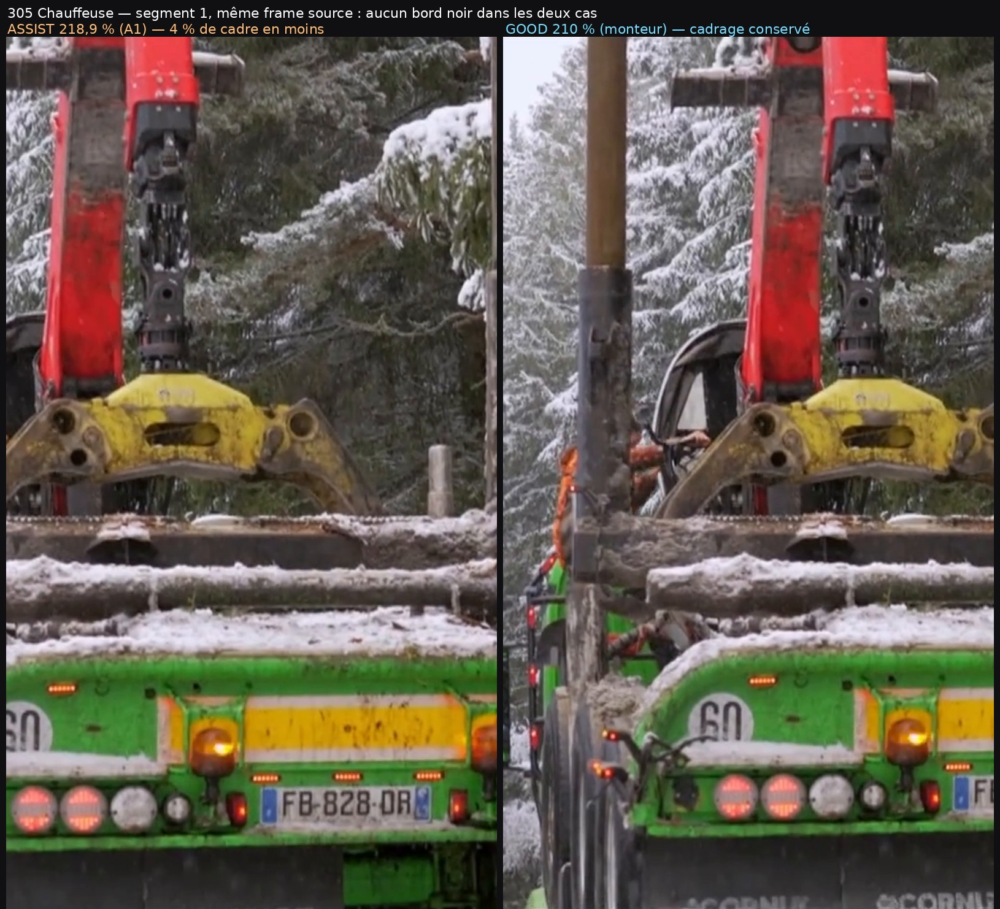

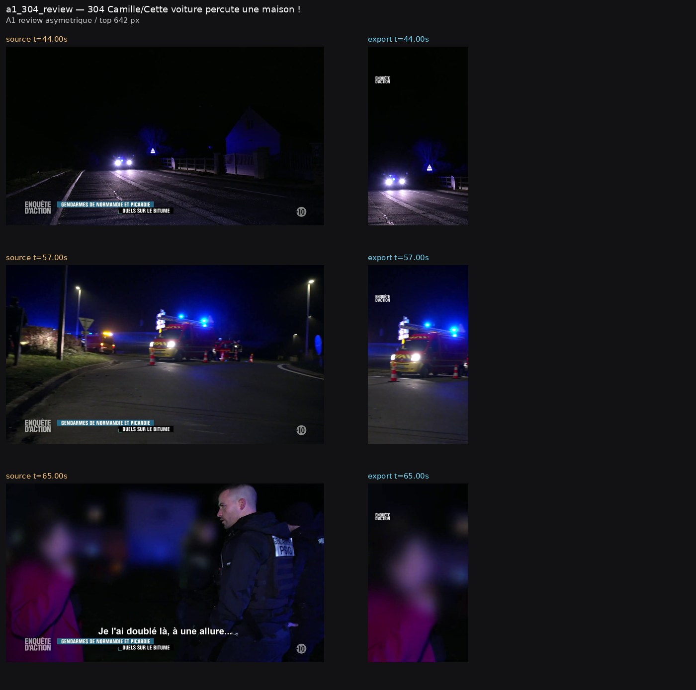

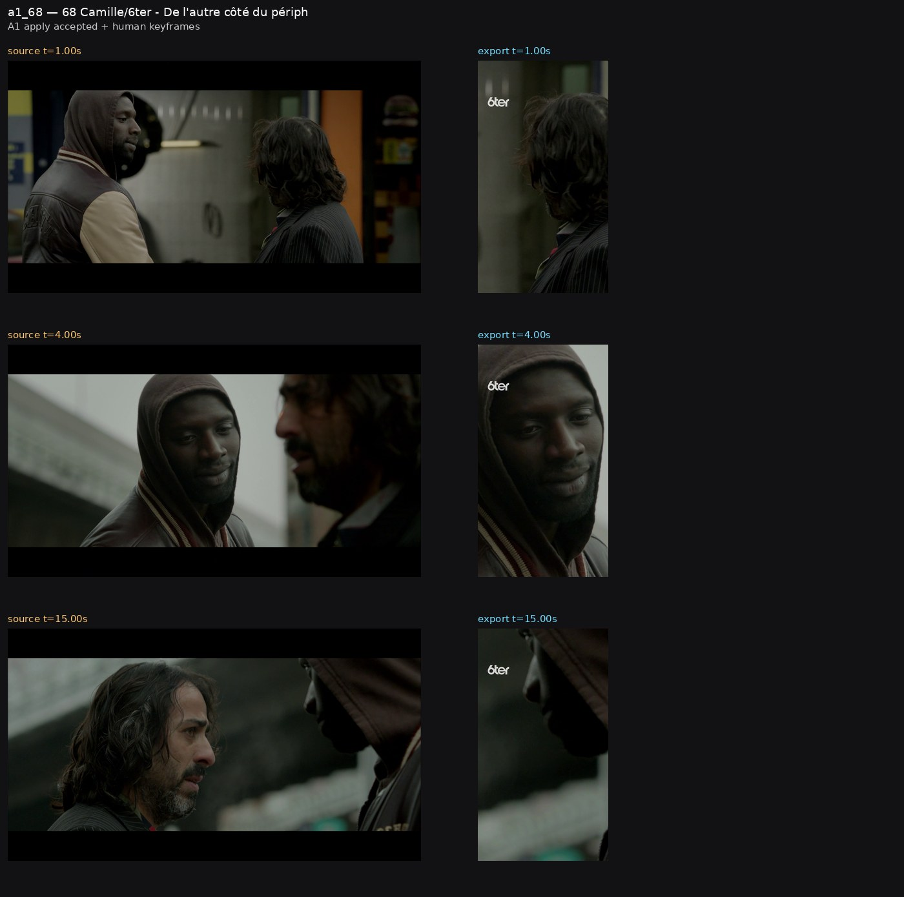

### 4.7 Recommandations A1

1. **Marge 1,04 → 1,015** (ou 1,01–1,02). Preuve : 51/65 applies ont une marge humaine ≤ 1,015, 53/65 ≤ 1,02, médiane 1,0125. Gain : les 15 segments du 305 (humain 210 % vs A1 218,9 %) et les 34 du 89 reviennent au cadrage humain, soit 49 des 51 cas ; sur-zoom réduit de **2,7 %** en médiane ; aucun bord noir réapparaît sur le 305 (barre réelle 81 px, fit exact à 210,5 %). Risque : les 7 segments du 68 (marge 1,04) et les 2 du 304 (1,0177) restent au-dessus de 1,015 ; garder `coverage` et un test de non-régression. Faisabilité : triviale (constante + tests).
2. **Différer A1 sur candidat A3** : si A3 a `candidate_keys ≥ 4` ou une amplitude ≥ 300 px avec gap < 0,3, A1 ne devrait appliquer que le scale, ou partir en `review` « keyframes probables ». Preuve : 18/65 applies A1 ont des keyframes humaines ; 304/89 concentrent les revers. Gain : éviter un double geste statique + suivi. Risque : barre résiduelle avant le keyframing. Faisabilité : moyenne (ordre A3/A1 dans `run.rs`).
3. **Conserver le veto asymétrique** : 92/99 correct. Ne pas assouplir.
4. **Ne pas traiter les barres horizontales** : 86 `noop` avec barres gauche/droite > 8 px sont hors comp en 9:16 (le contenu 1920×1080 couvre largement 1080 de large). A1 a raison de les ignorer.

---

## 5. A2 — bannières et bandeaux

### 5.1 Décisions

| Issue | Nombre |
|---|---:|
| `apply` | 5 |
| `review` | 61 |
| `noop` | 11 |

### 5.2 Les 5 applies

| Projet | Bande | Cible A2 | Ratio GOOD/ASSIST médian | Segments exacts | Verdict |
|---|---:|---:|---:|---:|---|
| 304 Il dément… | 84 px, 88 % | 202,4 % | 1,023 | 0/12 (10 à 1,023) | accepté, humain +2,3 % |
| 40 CITROUILLES | 112 px, 50 % | 208,3 % | 1,000 | 37/48 | accepté, 11 segments + zoom |
| 54 CLIENT HOTEL | 76 px, 59 % | 200,8 % | 1,000 | 43/54 | accepté, 11 segments + zoom |
| 58 CROUSTY | 120 px, 59 % | 210,0 % | 1,029 | 0/20 (16 à 1,029) | accepté, humain +2,9 % |
| 81 belle-mère | 104 px, 95 % | 206,6 % | 1,000 | 23/23 | accepté |

**Aucun apply A2 n'a été reverté.** Les 5 projets conservent l'échelle A2 ou l'augmentent légèrement. Le taux exact (103/157 segments, 65,6 %) sous-estime l'acceptation : les 28 segments « + » sont des zooms humains supplémentaires, pas des rejets. Le champ brut `apply_acceptance` de l'extraction indiquait 4 `reverted` : il est fondé sur la disparition stricte de la bbox (padding inclus) et non sur la conservation de l'échelle ; le contrôle GOOD/ASSIST corrige cette lecture.

Le cas **40 CITROUILLES** mérite une note : la bande commence à y=900 et non au bas du cadre ; A2 applique 208,3 %, ce qui laisse 45 px de **padding de bande** en bas. Le texte, lui, est retiré (contrôle visuel). Il ne faut donc pas durcir la formule sur la base de la bbox complète : la bbox inclut du padding. Le cas **81** laisse 2,8 px de padding, également sans texte.

### 5.3 Les 61 revues

| Catégorie | n | Comportement humain | Verdict A2 |
|---|---:|---|---|
| `tall_bottom` (décor bas) | 21 | 0 segment retiré (sauf 1–2 isolés) | **21 veto correct** |
| `top` (bande haute) | 16 | 11 sans retrait, 5 retraits partiels (4/18, 7/14, 18/33, 1/33, 1/22) | **16 veto correct** ; revue utile |
| `partial_width` (bande basse 37–45 %) | 9 | **bbox hors comp sur 324/326 segments (99,4 %)** ; 7 projets à 100 %, 2 à 46/47 et 33/34 | **9 applies manqués** |
| `animated` (bande basse animée) | 8 | 7 veto, 1 résolu (358 : 37/37) | 7 veto correct, 1 apply manqué |
| `logo` (logo/watermark) | 4 | contrôle 325 : logo toujours visible ; les 4 restent des logos fixes | **4 veto correct** |
| `changing_text` (sous-titres) | 3 | 19/44, 7/50, 0/19 retirés | **3 veto correct** (D-051) |

#### Les 9 `partial_width` : le principal gisement A2

| Projet | Largeur | Bbox hors comp | Issue |
|---|---:|---:|---|
| 77 CHAT HYPOALLERGENIQUE | 39 % | 43/43 | résolue |
| 80 belle-mère | 37 % | 23/23 | résolue |
| 359 EQUIPEMENT | 43 % | 65/65 | résolue |
| 304 Cette voiture | 43 % | 45/45 | résolue |
| 81 Elles refusent | 37 % | 14/14 | résolue |
| 304 À peine son permis | 45 % | 18/18 | résolue |
| 359 TERRASSE | 43 % | 37/37 | résolue |
| 359 LYCEENS | 43 % | 46/47 | quasi |
| 77 HOTEL POUR CHATS | 39 % | 33/34 | quasi |

Le monteur applique exactement la formule A2 : dans 77/80, l'échelle GOOD est 206,9–207,0 %, soit `1920 / (1080 − 96) × 1,05 ≈ 204,9 %` à 1 % près. Le gate `width_frac < 0.50` intervient **avant l'OCR** : ces 9 cas n'ont donc pas de preuve OCR (`ocr: null`). C'est le point de plus fort gain du corpus.

### 5.4 Cas qualitatifs

- **54 CLIENT HOTEL** : bandeau bas « UN JOUR UN DOC… », A2 apply 200,8 %, export sans bandeau ; accepté.
- **77 CHAT** et **80 belle-mère** : bandeaux bas partiels 39 % et 37 %, A2 review, humain 207 %, export sans bandeau. **Apply manqué**.
- **325 Océane (logo)** : A2 veto « logo ou watermark fixe, jamais recadré ». L'export conserve bien le logo, déplacé en haut à gauche par le recadrage. Cropper ne le supprime pas ; **veto correct**. Le compteur `n_removed` est trompeur ici : il mesure la sortie de bbox, pas la disparition du logo.
- **40 CITROUILLES** : A2 apply 208,3 %, humain conserve l'échelle ; 45 px de padding de bande restent en bas, sans texte. **Apply accepté**, mais la bbox de bande ne doit pas servir de mesure de résidu.
- **81 belle-mère** : A2 apply 206,6 %, humain conserve 23/23 ; 2,8 px de padding, sans texte.

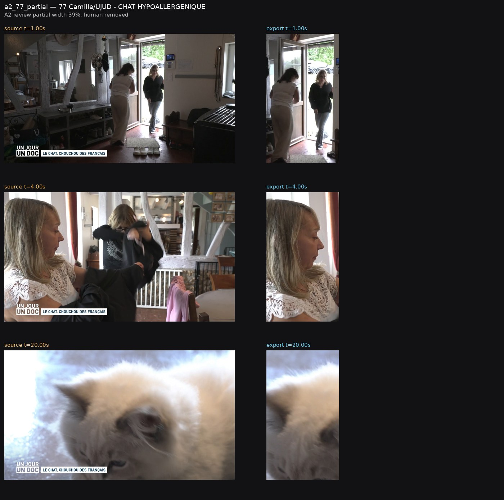

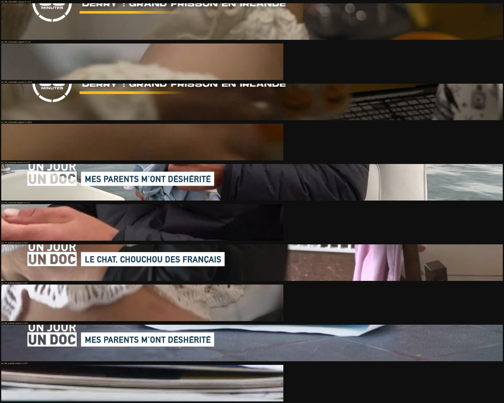

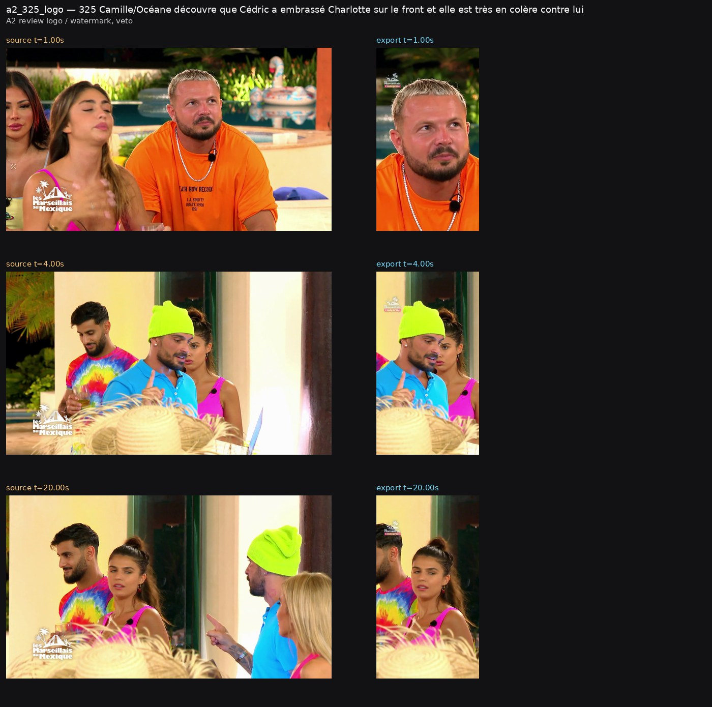

### 5.5 Recommandations A2

1. **Abaisser `BANNER_MIN_WIDTH` de 0,50 à 0,35** pour les bandes **basses**, persistantes, avec texte OCR confirmé. Preuve : 9/9 cas 37–45 %, bbox hors comp sur 324/326 segments, 7 projets à 100 %. Gain : +9 applies, ~326 segments de bandeau en moins. Risque : bandeau éditorial partiel (nom, lower-third) ; exiger `bottom`, `height 24–200`, `persistence ≥ 0,60`, `OCR Confirmed` et géométrie stable. Faisabilité : moyenne (déplacer le gate de largeur après l'OCR).
2. **Exécuter l'OCR avant le rejet de largeur** : aujourd'hui le gate 0,50 court-circuite l'OCR. Pour les bandes basses 0,35–0,50, l'OCR doit décider. C'est cohérent avec D-051/D-055 (`a2_ocr = true`).
3. **Ne pas modifier la formule d'échelle sur la bbox de bande** : la bbox inclut du padding ; 40 et 81 sont acceptés avec un résidu de padding sans texte. Si un résidu gêne, utiliser la bbox OCR du texte, pas la bbox de bande.
4. **Conserver les vetos** : `tall_bottom` 21/21, `logo` 4/4, `changing_text` 3/3, `top` 16/16. Les bandes hautes et les logos ne doivent pas être appliqués automatiquement.
5. **Surveiller `animated`** : 7/8 veto correct, 1 résolu (358). Garder le veto, mais le cas 358 montre qu'une bande animée peut être retirée par le monteur ; à revoir avec OCR + stabilité.

---

## 6. A3 — keyframes et recadrage

### 6.1 Décisions

| Issue | Nombre |
|---|---:|
| `review` | 456 |
| `noop` | 2 150 |

### 6.2 Matrice stricte (keyframes)

| | Humain keyframes | Humain sans keyframes |
|---|---:|---:|
| A3 review | **69** | **387** |
| A3 noop | **248** | **1 902** |

- Précision : **15,1 %**.
- Rappel : **21,8 %**.
- F1 : 0,177.

C'est cohérent avec D-030 (précision 0,20, rappel 0,23 sur 1 059 segments) : le corpus GOOD ne sauve pas A3, il confirme le diagnostic.

### 6.3 Matrice tolérante (keyframes ou déplacement statique ≥ 40 px ou structurel)

| | Intervention | Aucune |
|---|---:|---:|
| A3 review | **167** | **289** |
| A3 noop | **1 218** | **932** |

- Précision : **36,6 %**.
- Rappel : **12,1 %**.

La lecture tolérante montre qu'A3 rate surtout des **recadrages statiques** (949 `noop` forts), pas seulement des keyframes. Ce n'est pas le même besoin : A3 est un détecteur de tracking, pas un moteur de recadrage statique.

### 6.4 Quand A3 est-il pertinent ?

Taux de keyframes humaines sur les 456 revues A3, par amplitude :

| Amplitude source | n | Keyframes | Statique fort | Aucune |
|---|---:|---:|---:|---:|
| 100–150 px | 171 | **2,9 %** | 70,8 % | 25,1 % |
| 150–250 px | 165 | **12,1 %** | 49,7 % | 37,6 % |
| 250–400 px | 80 | **31,3 %** | 32,5 % | 36,3 % |
| 400–700 px | 31 | **38,7 %** | 22,6 % | 38,7 % |
| ≥ 700 px | 9 | **77,8 %** | 22,2 % | 0 % |

Par nombre de clés candidates :

| Clés candidates | n | Keyframes | Statique fort | Aucune |
|---|---:|---:|---:|---:|
| 2 | 241 | **4,1 %** | 67,6 % | 27,4 % |
| 3 | 128 | **18,0 %** | 43,0 % | 38,3 % |
| 4 | 51 | **37,3 %** | 21,6 % | 41,2 % |
| 5 | 18 | **22,2 %** | 27,8 % | 50,0 % |
| 6 | 18 | **72,2 %** | 22,2 % | 5,6 % |

**Lecture** : en dessous de 250 px, A3 revue est essentiellement du bruit pour les keyframes ; le monteur fait un recadrage statique (70,8 %) ou rien. À 250–400 px, un tiers des cas sont des keyframes ; à ≥ 700 px, 78 %. Les 2 clés candidates sont presque toujours un faux signal (4,1 %), alors que 6 clés sont crédibles (72,2 %).

### 6.5 Les FN `noop` : le gap est le principal coupable

Taux de keyframes humaines sur les `noop` A3, par amplitude :

| Amplitude | n | Keyframes |
|---|---:|---:|
| < 50 px | 907 | 5,5 % |
| 50–100 px | 688 | 4,1 % |
| 100–200 px | 339 | **20,4 %** |
| 200–400 px | 167 | **42,5 %** |
| ≥ 400 px | 49 | **61,2 %** |

Par trou de suivi (amplitude ≥ 100 px) :

| Gap | n | Keyframes |
|---|---:|---:|
| < 30 % | 5 | 0 % |
| 30–50 % | 138 | **24,6 %** |
| 50–70 % | 169 | **29,6 %** |
| 70–90 % | 181 | **34,8 %** |
| 90–100 % | 62 | **37,1 %** |

**Lecture** : A3 exige `gap < 0,3`. Or le monteur keyframe encore **24,6–37,1 %** des segments à gap 30–100 %. Le signal de tracking est absent par trous, mais l'humain sait interpoler ou suivre un autre objet. Le gate `gap < 0,3` est la principale cause des 248 FN keyframes.

### 6.6 Qualité du tracking

- 69 revues A3 avec keyframes humaines.
- Corrélation médiane : **0,99**.
- 59/69 (85,5 %) ≥ 0,6.
- Les 10 autres sont des keyframes « autres » (recadrage différent, objet non recommandé).

Quand A3 propose des clés et que l'humain keyframe, la trajectoire est donc **très bonne**. Le problème est de savoir **quand** proposer, pas **comment** suivre.

### 6.7 Recadrage statique : le besoin non couvert

- **1 045 segments** ont un déplacement statique fort (≥ 40 px source) : 96 en `review`, 949 en `noop`.
- A3 n'en couvre que **96 (9,2 %)**.
- 317 segments appariés à une décision A3 portent des keyframes humaines (1 363 clés), dont **261 (82,3 %) entre 2 et 6 clés**.
- Sur 1 555 segments avec un déplacement statique (fort ou faible) et des objets STEP4 :
  - le centre source humain est à **19,6 px** médian de l'objet suivi le plus proche (oracle) ; **72,1 %** à ≤ 60 px ;
  - la recommandation STEP4 actuelle est à **78,8 px** médian ; **46,0 %** à ≤ 60 px ;
  - pour les déplacements ≥ 300 px, l'objet le plus proche est à **49,1 px** médian, la recommandation à **548 px**.

**Lecture** : le monteur ne recadre pas au hasard ; il vise souvent un objet suivi. Mais la recommandation STEP4 choisit souvent le mauvais objet (ou un objet différent de celui que le monteur privilégie). Une automatisation statique « centrer l'objet recommandé » serait fausse dans plus de la moitié des cas. Il faut d'abord améliorer la sélection d'objet (saillance, parole, continuité, taille), ou présenter les candidats en revue.

### 6.8 Cas qualitatifs

- **313 W9 LAA9** : 101 segments, nombreux recadrages statiques manuels (segment 1 : −1 094 px ; segment 3 : +493 px). A3 `noop` car segments courts ou mouvement faible/instable ; l'export centre le bon sujet. C'est le besoin « recadrage statique », pas « keyframes ».
- **54 CLIENT HOTEL** : A3 review sur des segments de suivi ; l'humain keyframe et l'export suit le visage. Corrélation 0,99. **TP**.
- **304 Cette voiture** : A3 `noop` sur des segments à gap élevé alors que l'humain keyframe (3–8 clés). **FN** typique du gate gap.

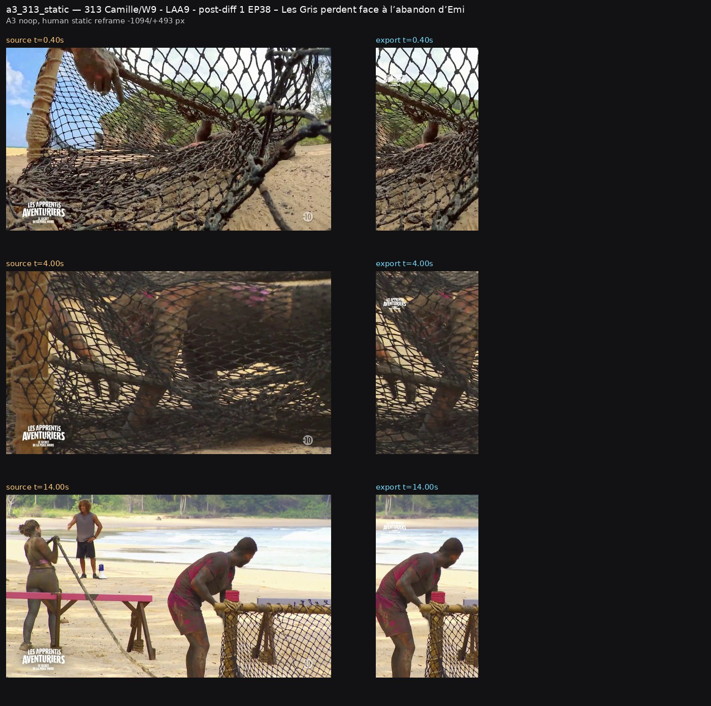

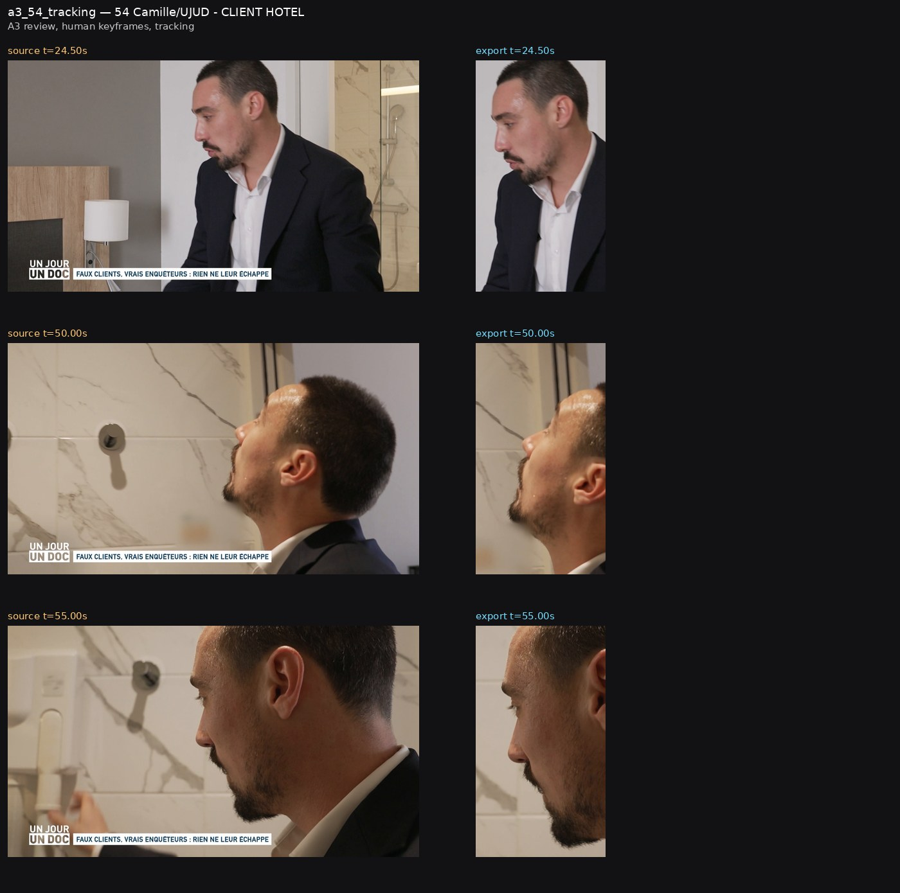

### 6.9 Recommandations A3

1. **Rester en review-only** (D-030/D-032). Ne pas activer A3 apply : 15,1 % de précision stricte, 36,6 % en tolérant ; le risque de keyframes destructrices est trop élevé.
2. **Trier les revues** :
   - `noop` si amplitude < 250 px **et** `candidate_keys ≤ 2` : -171 revues (37,5 %), -4 TP seulement. Précision des revues restantes : 65/285 ≈ 22,8 %.
   - `review` si amplitude ≥ 250 px ou `candidate_keys ≥ 3`.
   - `review haute confiance` si amplitude ≥ 700 px **ou** `candidate_keys = 6` (précision 72–78 %).
3. **Assouplir le gap uniquement pour la revue** : `gap < 0,7` (au lieu de 0,3) quand amplitude ≥ 200 px. Gain : +216 revues, +101 keyframes humaines (40,7 % des FN), précision ~47 %. Risque : +216 revues ; à faire en review-only, pas en apply.
4. **Ne pas automatiser le recadrage statique** : 1 045 segments, mais la recommandation STEP4 ne colle qu'à 46 %. Ajouter éventuellement un champ de rapport `static_reframe_candidate` (objet, écart, spread) sans action ; ou améliorer la sélection d'objet en amont.
5. **Conserver le skip < 1 s pour les keyframes** : 97 segments, seulement 4 keyframes (4,1 %), mais 66 recadrages statiques. Le skip est bon pour A3, pas pour un futur A7 statique.

---

## 7. A4 — segments courts

### 7.1 Décisions

| Issue | Nombre |
|---|---:|
| `review` | 20 |
| `apply` | 0 |

### 7.2 Résultats

- 9 actions humaines : 7 `extend`, 2 `split`.
- 11 `none`.
- Précision stricte : **45 %**.
- Précision tolérante : **80 %** (9 actions + 7 flashes < 0,3 s = 16/20).
- 4 faux alarms : `none` avec durée ≥ 0,3 s.

| Durée | n | `extend` | `split` | `none` |
|---|---:|---:|---:|---:|
| < 0,2 s | 7 | 2 | 0 | 5 |
| 0,2–0,3 s | 4 | 2 | 0 | 2 |
| 0,3–0,4 s | 2 | 0 | 1 | 1 |
| 0,4–0,5 s | 7 | 3 | 1 | 3 |

**Lecture** : A4 n'a pas de seuil de durée qui sépare proprement les actions des flashes. Les 7 `none` < 0,3 s sont des flashes/transitions, correctement laissés ; les 2 `extend` < 0,2 s montrent que le monteur peut aussi vouloir étendre un flash. A4 est une revue de prudence à faible volume (20), pas un moteur de fusion.

### 7.3 Cas qualitatifs

- **79 Gulli MSL1** : segment 0,40 s, A4 review, humain split en 3 parties (30,4/30,8/31,2 s). **TP** : le segment court était un vrai découpage à corriger.
- **8 Totally Spies** : segment 0,12 s, A4 review, humain laisse. **Veto correct** : flash/transition.

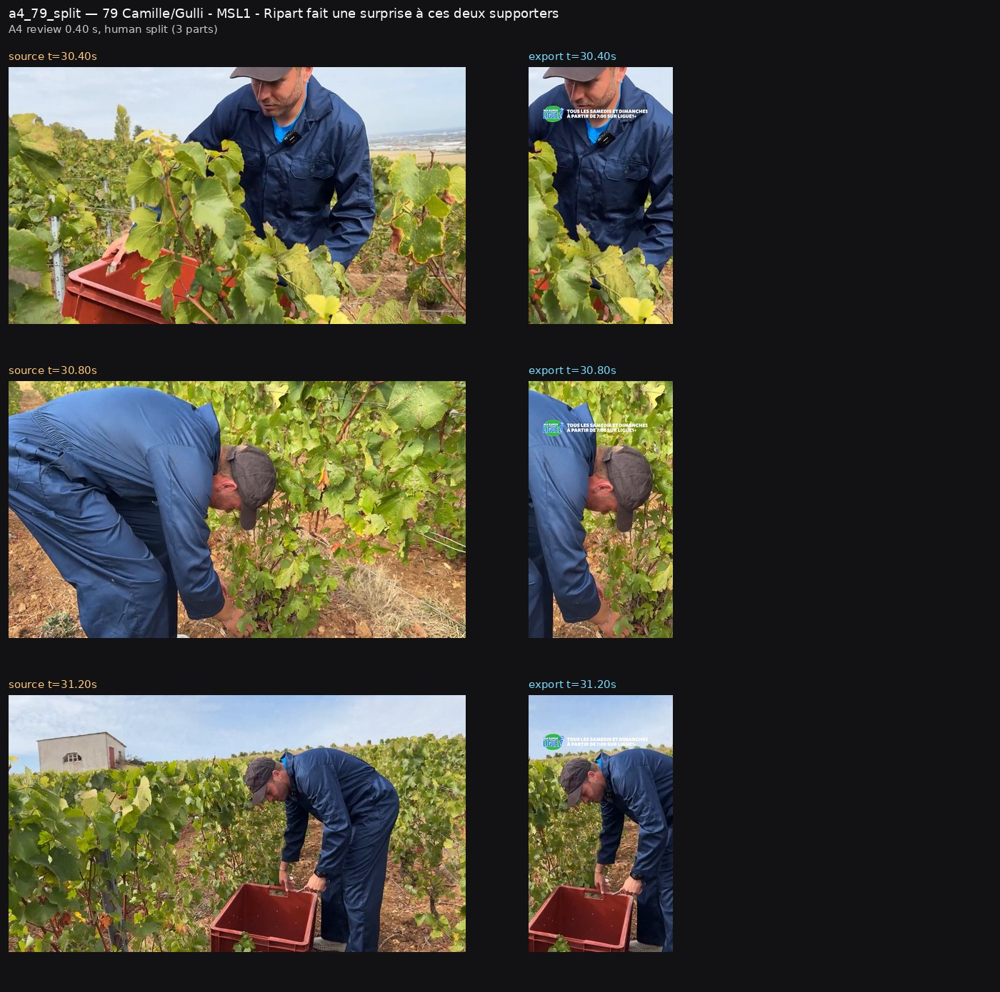

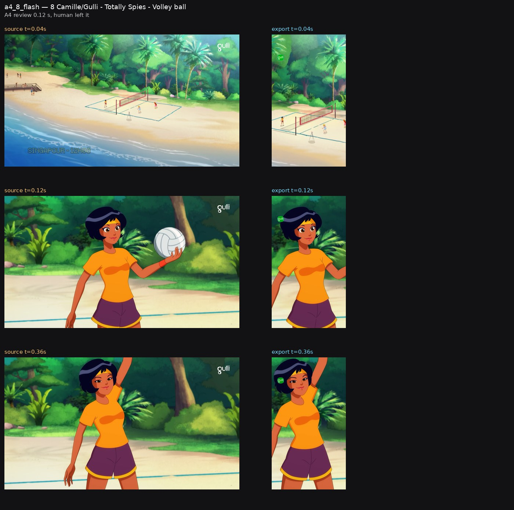

### 7.4 Recommandation A4

- **Conserver A4 en review-only**, sans fusion automatique.
- **Ajouter un tag `flash probable`** pour les segments < 0,3 s sans continuité de source avec le voisin, plutôt que de supprimer la revue : 7/11 `none` sont des flashes, mais 2 `extend` < 0,2 s existent.
- **Ne pas utiliser A4 comme correcteur structurel global** : il couvre 9 des 177 événements humains (89 splits, 35 extends, 27 duplicates, 8 trims). Les splits/duplicates relèvent d'un autre outil.

---

## 8. A5 et A6

### 8.1 A5 — couverture source

- 17 revues, toutes dans `62 SHORT_oléagineux`.
- 17/17 `good_covers_comp = true` : le recadrage humain couvre la composition.
- Audit du projet : `warn` (le seul du corpus).
- **Verdict** : A5 est un avertissement de couverture source, pas un défaut final. Il est utile comme rapport, mais ne doit jamais appliquer de recadrage. Les 17 revues sont résolues par le monteur ; les classer « resolved » dans le rapport, pas « FP ».

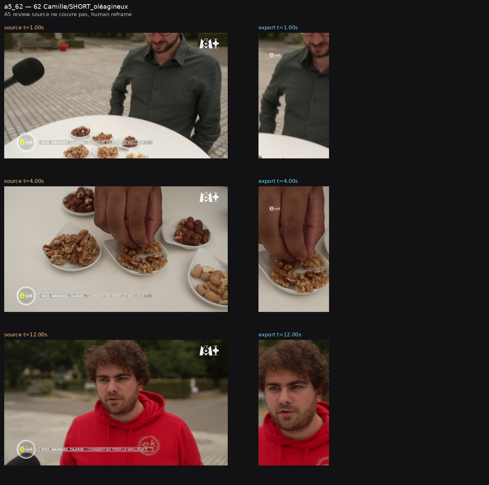

### 8.2 A6 — template SDM

- 1 projet : `328 M6 - SDM - Leslie et Léo`.
- 1 `apply` : template 3 panneaux, logo `sdm.png`, mono-segment, sans keyframe.
- GOOD identique : 3 segments (main/small/background) aux mêmes échelles (84,35 %, 56,29 %, 180 %), logo présent.
- **Verdict : 1/1 correct**. Aucun changement.

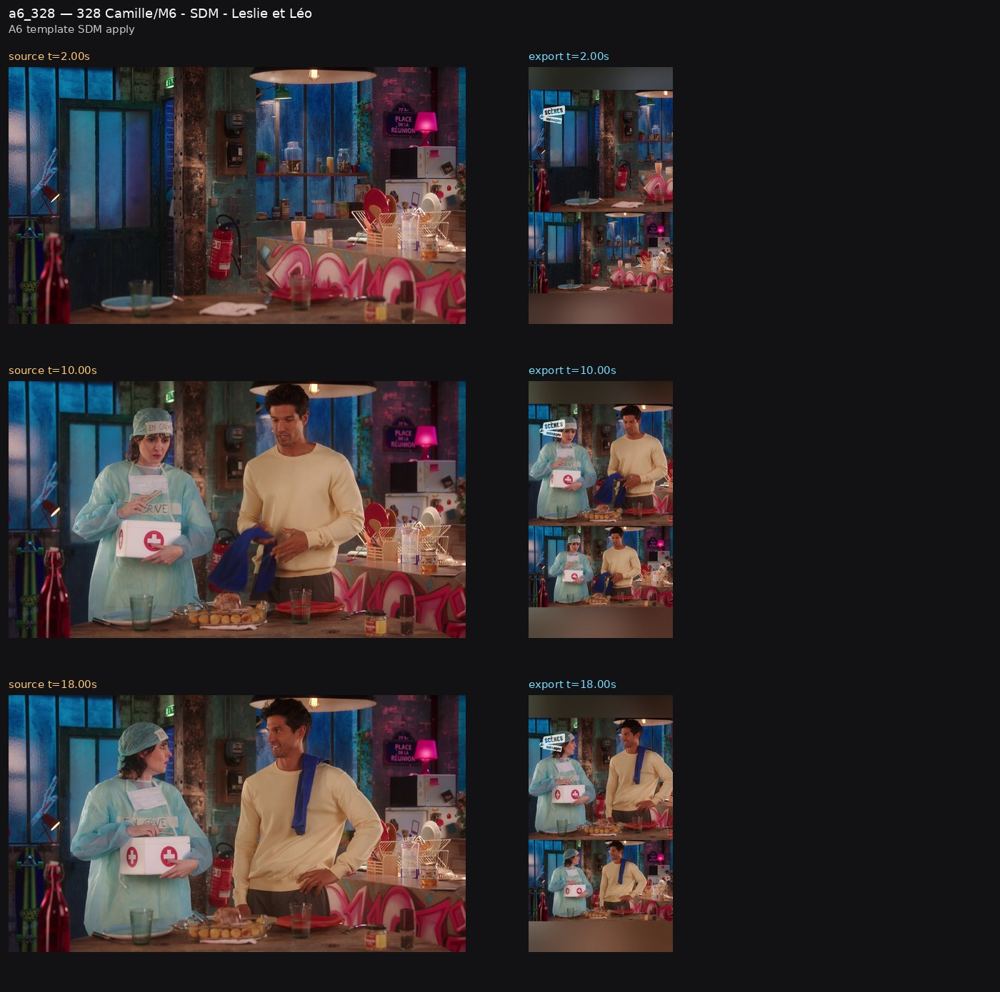

---

## 9. Timeline, habillage et exports

### 9.1 Éditions structurelles humaines

| Type | Nombre |
|---|---:|
| Split | 89 |
| Extend | 35 |
| Duplicate | 27 |
| Trim | 8 |
| Add | 15 |
| Overlap | 2 |
| Mixed | 1 |
| **Total** | **177** |

47/75 projets ont au moins une édition structurelle. Les splits dominent (3,4 % des segments). A3/A4 n'en couvrent qu'une petite partie : A4 9 actions, A3 3 structurels. Un futur lot pourrait ajouter une revue « split/duplicate » basée sur les scènes source, mais le corpus ne fournit pas de règle déterministe assez précise.

### 9.2 Habillage

- 55/75 projets ont au moins une couche d'habillage.
- 72 couches : 71 `Footage`, 1 `Solid`.
- Seules 2 couvrent toute la composition ; les autres sont des logos, lower-thirds, bandeaux ou incrustations.
- 42/58 projets avec revue A2 et 48/68 avec revue A3 ont un habillage. Les overlays sont donc le contexte majoritaire des revues : A2/A3 doivent distinguer un bandeau éditorial d'un habillage.
- D-052 (registre logos report-only) est cohérent : le logo 325 reste visible après recadrage ; un veto « logo seul » est correct.

### 9.3 Exports

| Indicateur | Valeur |
|---|---:|
| Exports scannés | 71 |
| Résolution | 1080×1920 (71/71) |
| FPS | 25/1 (71/71) |
| `max_top = 0` | 68/71 |
| `max_bottom = 0` | 71/71 |
| `max_left = 0` | 69/71 |
| `max_right = 0` | 71/71 |
| Full frame dominant | 67/71 |
| Anomalies | 4 projets (335 ×2, 356, 304), 1 à 31 frames, toutes à t=2–32 s |

Aucun export n'a de bord latéral de 4 px : le premier scan, en arrondi 16 px, fabriquait ces bords (1080 → 1072). Au pas de 2 px, 67/71 exports sont pleine frame sur toute la durée ; les 4 autres n'ont que des anomalies ponctuelles d'intro/transition, jamais sur un segment corrigé par A1. Le seul projet A1 apply sans export est le 305, validé par rendu synthétique : aucun bord noir à 210 % (humain) ni à 218,9 % (A1).

---

## 10. Règles déterministes proposées

Priorité : **P1** = à implémenter dans un prochain lot court ; **P2** = à valider sur un lot de copies ; **P3** = recherche.

| ID | Règle | Preuve | Gain | Risque | Faisabilité |
|---|---|---|---|---|---|
| **R1** | A1 : marge `1,04 → 1,015` (borne 1,01–1,02) | 51/65 marges humaines ≤ 1,015 ; médiane 1,0125 ; ratio GOOD/ASSIST 0,9736 ; 305 : humain 210 %, A1 218,9 %, aucun bord noir | Sur-zoom réduit de 2,7 % ; 15 segments 305 et 34 du 89 au cadrage humain | Les 2 segments du 68 et du 304 restent au-dessus ; garder coverage | **P1**, triviale |
| **R2** | A1 : si A3 `candidate_keys ≥ 4` ou amplitude ≥ 300 px et gap < 0,3 → apply scale seul ou review « keyframes probables » | 18/65 applies A1 ont des keyframes humaines ; 304/89 concentrent les revers | Évite double correction statique + suivi | Barre résiduelle avant keyframing | **P2**, moyenne |
| **R3** | A2 : `BANNER_MIN_WIDTH 0,50 → 0,35` pour bande basse persistante + OCR confirmé ; déplacer le gate après OCR | 9 revues 37–45 % ; bbox hors comp sur 324/326 ; 7 projets à 100 % | +9 applies, ~326 segments de bandeau | Bandeau éditorial partiel ; exiger bottom + OCR + stabilité | **P1**, moyenne |
| **R4** | A2 : ne pas durcir la formule sur la bbox de bande ; utiliser la bbox OCR du texte pour le résidu | 40 : 45 px de padding sans texte ; 81 : 2,8 px | Évite un sur-zoom inutile | Aucun si OCR fiable | **P1**, rapport/QA |
| **R5** | A3 : `noop` si amplitude < 250 px et `candidate_keys ≤ 2` ; `review` sinon ; tag haute confiance si amplitude ≥ 700 px ou 6 clés | 100–150 px : 2,9 % keyframes ; 2 clés : 4,1 % ; 6 clés : 72,2 % ; ≥700 px : 77,8 % | -171 revues (37,5 %), -4 TP ; précision 15,1 → 22,8 % | Perte de 4 keyframes à faible amplitude | **P1**, faible |
| **R6** | A3 : pour la revue seulement, `gap < 0,7` si amplitude ≥ 200 px | Gap 30–100 % : 24,6–37,1 % keyframes humaines | +216 revues, +101 keyframes (40,7 % des FN), précision ~47 % | +216 revues | **P2**, faible |
| **R7** | A3 : ne jamais activer apply ; ne pas automatiser le recadrage statique | 15,1 % précision stricte ; 1 045 static, 96 couverts ; recommandation 46 % vs objet 72 % | Évite keyframes/recadrages destructifs | Aucun ; garde le review | **P1**, aucune |
| **R8** | A4 : garder review-only ; tag `flash probable` < 0,3 s ; pas de fusion auto | 20 revues, 9 actions, 7 flashes veto ; 80 % tolérant | Moins de bruit sans perdre les 2 extends < 0,2 s | 4 faux alarms ≥ 0,3 s | **P1**, faible |
| **R9** | A5 : garder report-only ; classer `resolved` ; pas d'apply | 17/17 couverture finale | Aucun geste destructif | Bruit de rapport | **P1**, aucune |
| **R10** | A6 : inchangé | 1/1 accepté | — | — | — |
| **R11** | Timeline : étudier split/duplicate (89/27) dans un lot séparé | 177 événements, A4 n'en couvre 9 | Potentiel élevé | Pas de règle déterministe | **P3** |

### 10.1 Ce qu'il ne faut pas faire

- **Ne pas activer A3 apply** même avec un seuil haute confiance : 7/9 à ≥ 700 px, mais seulement 9 cas ; le risque sur les 250–700 px reste élevé.
- **Ne pas automatiser le recadrage statique** : 1 045 segments, mais la recommandation STEP4 ne colle qu'à 46 %. Un modèle de sélection d'objet est nécessaire.
- **Ne pas supprimer A4** : 9 actions humaines, 7 flashes correctement laissés ; c'est une revue utile à faible volume.
- **Ne pas compter les 4 px latéraux comme un défaut** : ils n'existent pas. L'arrondi 16 px du premier scan les fabriquait ; en arrondi 2 px, 69/71 exports sont pleine largeur.
- **Ne pas utiliser `n_removed` seul pour A2 logo** : le logo peut sortir de la bbox tout en restant visible.

---

## 11. Décision D-056

Décision **validée le 8 novembre 2026** et enregistrée dans `memory-bank/decisionLog.md`.

> **D-056 : réglage A1/A2/A3 issu du corpus GOOD**
>
> - **Contexte** : étude read-only de 75 triplets `_9x16` / `_assist` / `_assist_GOOD` (2 609 segments, 71 exports), 8 novembre 2026.
> - **Constats** :
>   1. A1 : 65 applies ; marge humaine médiane 1,0125, 51/65 ≤ 1,015 et 53/65 ≤ 1,02 ; la marge 1,04 sur-zoome de **2,7 %** ; 18/65 segments keyframés ; 56/65 résidus géométriques ≤ 8 px ; 68/71 exports sans barre haute (71/71 sans barre basse) ; 305 : humain 210 % vs A1 218,9 %, aucun bord noir dans les deux cas (barre réelle 81 px, estimée 86).
>   2. A2 : 5/5 applies conservés ; 9 revues `partial_width` 37–45 % avec bbox hors comp sur 324/326 segments ; le gate 0,50 précède l'OCR.
>   3. A3 : 69 TP keyframes sur 456 revues (15,1 % précision, 21,8 % rappel) ; 1 045 recadrages statiques forts, 96 couverts ; recommandation STEP4 alignée sur l'humain dans 46 % des cas.
>   4. A4 : 20 revues, 9 actions, 11 `none`, 80 % tolérant ; A5 : 17/17 résolues ; A6 : 1/1.
> - **Décision** :
>   1. A1 : marge **1,015** (1,01–1,02), tests de couverture conservés ; différer A1 sur candidat A3 (P2).
>   2. A2 : seuil de largeur **0,35** pour les bandes basses persistantes, avec OCR exécuté avant le gate ; conserver les vetos tall/top/logo/changing_text.
>   3. A3 : reste **review-only** ; tri par amplitude/nombre de clés ; gap < 0,7 en revue seulement ; pas d'apply, pas de recadrage statique automatique.
>   4. A4 : reste review-only, tag flash, pas de fusion auto. A5 : report-only. A6 : inchangé.
>   5. Aucun code de production n'est modifié dans cette étude ; ces règles sont la base d'un prochain lot court (R1/R3/R5) et d'un lot de validation (R2/R6).
> - **Validation** : rapport `docs/etudes/ETUDE-CORPUS-GOOD-POST-STEP8.md` ; 75 projets ; 71 exports ; 4 exports manquants (305, 364, 86×2), 305 validé par rendu synthétique.
> - **Références** : D-030, D-032, D-051, D-052, D-055 ; `docs/lots/LOT-9-POST-STEP8.md` ; `docs/etudes/ETUDE-STEP9-AGENTIQUE.md`.

---

## 12. Annexes

### 12.1 Fichiers de travail

Les scripts, les données agrégées et les planches sont versionnés dans
[`ETUDE-CORPUS-GOOD-POST-STEP8/`](ETUDE-CORPUS-GOOD-POST-STEP8/README.md) :

- `scripts/common.py` : découverte, géométrie projetée, échantillonnage, barres.
- `scripts/inventory.py` : inventaire et cohérence review/post/ASSIST.
- `scripts/extract.py` : extraction projet par projet, `projects/*.json`, `segments.csv`, `decisions.csv`, `events.csv`.
- `scripts/scan_exports.py` : `ffprobe` + `cropdetect` sur les 71 exports, `exports_scan.csv`.
- `scripts/analyze.py` : métriques consolidées, `summary.json`.
- `scripts/make_frames.py`, `scripts/render_good.py` : contrôles visuels et rendus synthétiques.

Points de contrôle versionnés : `data/summary.json`, `data/inventory.csv`, `data/exports_scan.csv`, `images/*.jpg`. Les tables lourdes (`segments.csv`, `decisions.csv`, `projects/*.json`) et les frames PNG brutes (176 Mo) restent hors dépôt : elles se régénèrent par `scripts/extract.py` et `scripts/make_frames.py`.

### 12.2 Définitions des métriques

- **Marge humaine A1** : `échelle_GOOD / (1920 / hauteur_active × 100)`. 1,0 = aucun crop de sécurité ; 1,04 = marge A1.
- **Ratio GOOD/ASSIST** : `échelle_GOOD / échelle_ASSIST` sur les segments `same`/`trim`. 1,0 = A1/A2 conservé ; < 1 = humain moins zoomé ; > 1 = humain plus zoomé.
- **Résidu géométrique de barre** : chevauchement maximal, en pixels comp, entre le rectangle de barre détecté par A1 et la composition, sur 5 échantillons du segment. Ce n'est pas une mesure des pixels noirs de l'export (la barre détectée peut être plus épaisse que la barre réelle).
- **Déplacement statique fort** : `|source_center_GOOD − source_center_ASSIST| ≥ 40 px` (coordonnées source 1920×1080), sans keyframes.
- **Précision tolérante A3** : revues A3 avec keyframes, déplacement fort ou structurel / revues A3.
- **Veto correct** : revue sans action humaine dont l'abstention est justifiée (flash, logo, décor, sous-titre, asymétrie de contenu).

### 12.3 Reproductibilité

Les mesures sont déterministes à partir des artefacts :

```sh
cd docs/etudes/ETUDE-CORPUS-GOOD-POST-STEP8
export ETUDE_OUT=/tmp/opencode/etude-good/out
export ETUDE_CORPUS="/media/kidpixel/WORK/Backup/CLIENTS/Média Solution/Corpus_Exemple_2"

python3 scripts/inventory.py
python3 scripts/extract.py
python3 scripts/scan_exports.py
python3 scripts/analyze.py
```

Le corpus est lu en lecture seule ; aucun chemin `/mnt/cache`, `runtime/` ou `/home/kidpixel/workflow_mediapipe` n'est écrit. Le dossier `images/` est produit par `scripts/make_frames.py` et `scripts/render_good.py`.

### 12.4 Cas visuels

Les planches sont dans [`ETUDE-CORPUS-GOOD-POST-STEP8/images/`](ETUDE-CORPUS-GOOD-POST-STEP8/images/) ; l'index complet (cas, section, preuve) est dans le [`README`](ETUDE-CORPUS-GOOD-POST-STEP8/README.md) du dossier.

| Fichier | Cas |
|---|---|
| `A1-305-assist-vs-good.jpg` | 305, 218,9 % (A1) vs 210 % (humain) |
| `A1-68-apply-accepte-keyframes.jpg` | 68, apply A1 conservé |
| `A1-304-veto-ciel-nocturne.jpg` | 304, veto « barres asymétriques » |
| `A2-54-bandeau-applique.jpg`, `A2-40-padding-bande.jpg`, `A2-81-apply-conserve.jpg` | applies A2 conservés |
| `A2-77-bandeau-partiel-39.jpg`, `A2-80-bandeau-partiel-37.jpg`, `A2-zooms-bandeaux-bas.jpg` | bandeaux partiels non appliqués |
| `A2-325-logo-veto.jpg` | logo toujours visible après recadrage |
| `A3-313-recadrage-statique-noop.jpg`, `A3-54-tracking-tp.jpg` | statique manuel vs tracking A3 |
| `A4-79-split-040s.jpg`, `A4-8-flash-012s.jpg` | split 0,40 s vs flash 0,12 s |
| `A5-62-couverture-source.jpg` | source qui ne couvre pas le comp |
| `A6-328-template-sdm.jpg` | template SDM conservé |
| `A1-305-rendu-*.jpg`, `A1-356-rendu-good-seg2.jpg`, `A1-68-rendu-good-seg1.jpg`, `A2-40-rendu-good-seg1.jpg` | rendus synthétiques GOOD/ASSIST |

Rendus synthétiques : `A1-305-assist-vs-good.jpg`, `A1-305-rendu-good-seg1.jpg`, `A1-305-rendu-assist-seg1.jpg`, `A1-356-rendu-good-seg2.jpg`.

---

*Fin de l'étude. Les recommandations R1, R3, R5, R7, R8 et R9 sont prêtes pour un lot court ; R2 et R6 demandent une validation sur copies ; R11 est une perspective de recherche.*
